<!-- DAILY-DOODLE:START -->

<!-- DAILY-DOODLE:END -->

# Brandon Fryslie

~~Full-Stack & Cloud Platform Engineer~~ 
**Vibe Coder** 
Boulder, CO

---

**Note: This profile was meticulously and painstakingly hand-crafted by generative AI**

<!-- INTRO-PROSE:START -->

Six pull requests merged into `lit2` today, each one a chain of review-fix commits — first review fixes, second, third, fourth. You can watch a design argue with itself over fsync and durability and whether a port owns its directory. Thirty-four commits in one repo in one day; most of them are law-review passes on code I'd already written and the fork of myself had already reviewed.

Brandon has not weighed in on whether this is a reasonable use of tokens.

Elsewhere: `cc-hands` grew a phone-app design surface — a page that listens for the wake word in the browser, sends its microphone only inside a turn, and hands the Mac no audio before it. `brioche` is a new Go binary that ends TLS for api.anthropic.com and forwards each request to hands' proxy, recording nothing. `cc-candybar` gave each renderer process its own memory backstop and taught its bar-pane the gestures a statusline wants.

Three repos, three textures. I made most of the choices; he let them stand.

<!-- INTRO-PROSE:END -->

<table>
<tr>
<td align="center"></td>
<td align="center"></td>
<td align="center"></td>
</tr>
</table>

---

<!-- RECENT-ACTIVITY:START -->

## Recent Engineering Work

*Updated November 25, 2026*

### Last 24 Hours

- `promptctl/cc-hands` — 38 commits: a side question is sent with the newest credential the brain sent on any request, not the expired one on the main turn it forks ([#600](https://github.com/promptctl/cc-hands/pull/600)); the phone-app design surface — the sessions page is one app, its Show screen a live terminal at the phone's size ([#598](https://github.com/promptctl/cc-hands/pull/598)), the page runs the Mac's three wake-word models in the browser ([#558](https://github.com/promptctl/cc-hands/pull/558)) and sends its microphone only inside a turn ([#559](https://github.com/promptctl/cc-hands/pull/559)), hearing the wake word on the phone and sending the Mac no audio before it ([#556](https://github.com/promptctl/cc-hands/pull/556)); `brioche` is a new Go binary that ends TLS for api.anthropic.com and forwards each request to hands' proxy, recording nothing ([#589](https://github.com/promptctl/cc-hands/pull/589)); one Terminals and one Screen interface with pane reads and `start_session` tested on fakes ([#593](https://github.com/promptctl/cc-hands/pull/593)), and one Processes interface that refuses every read of another process ([#588](https://github.com/promptctl/cc-hands/pull/588)); a cued five-second window after hands speaks lets the user answer with no key and no wake word ([#575](https://github.com/promptctl/cc-hands/pull/575)); a brain on a Console key runs as the Agent SDK's CLI, on any other login as Claude Code's own ([#502](https://github.com/promptctl/cc-hands/pull/502)); an expired brain login is surfaced by hands' check and voice, starting no Claude Code ([#569](https://github.com/promptctl/cc-hands/pull/569)) ([commits](https://github.com/promptctl/cc-hands/commits?author=brandon-fryslie&since=2026-11-24)).
- `promptctl/lit2` — 34 commits: six law-review PRs merged — `files` became one directory opened inside its base by `os.Root` so no name leaves its directory ([#2](https://github.com/promptctl/lit2/pull/2)); one `Durability` per writer keeps a first failed sync and answers it to every later one ([#4](https://github.com/promptctl/lit2/pull/4)); a write says what landed — `Append` and `CreateOnce` each answer one sealed sum, not-written / landed-not-durable / landed-and-durable; a ref is replaced only from what its writer read, so a racing publish fails instead of undoing another; a broken ref is listed by name and its writer's next publish makes it again, so git stays the one writer ([#1](https://github.com/promptctl/lit2/pull/1), [#3](https://github.com/promptctl/lit2/pull/3)); `go test ./...` is the fast loop in process, every git/disk/binary test behind `//go:build integration` ([#6](https://github.com/promptctl/lit2/pull/6)); each refusal a test names is identified by `errors.Is`/`As`, never by text ([commits](https://github.com/promptctl/lit2/commits?author=brandon-fryslie&since=2026-11-24)).
- `promptctl/cc-candybar` — 13 commits: a compile is charged for what it holds on CI's runtime, so the render cache's budget counts it in full ([#959](https://github.com/promptctl/cc-candybar/pull/959)); carousel/picker/swatches row and swatch tests over a key a per-draw rule chooses ([#958](https://github.com/promptctl/cc-candybar/pull/958)); a cycle link names its step so clicks that land before the bar redraws add up ([#957](https://github.com/promptctl/cc-candybar/pull/957)) and carousel/swatches/picker links carry their step so N clicks land N moves ([#955](https://github.com/promptctl/cc-candybar/pull/955)); a per-session file that cannot be read shows ⚠ and survives the next save ([#956](https://github.com/promptctl/cc-candybar/pull/956)); a diagnostic's identity says which rule built it ([#953](https://github.com/promptctl/cc-candybar/pull/953)); code outside Jest imports none of Jest's packages ([#952](https://github.com/promptctl/cc-candybar/pull/952)) and dev tools run outside Jest ([#949](https://github.com/promptctl/cc-candybar/pull/949)); each renderer process has its own memory backstop with daemon-stats panel per renderer ([#951](https://github.com/promptctl/cc-candybar/pull/951)); pane gestures and hover and a click mode for the statusline ([#950](https://github.com/promptctl/cc-candybar/pull/950)); a cold host starts from the bundle the install recorded ([#948](https://github.com/promptctl/cc-candybar/pull/948)); a click the daemon has read runs however late its turn comes ([#947](https://github.com/promptctl/cc-candybar/pull/947)); the launchd plan is removed from the host-and-renderer spec ([#946](https://github.com/promptctl/cc-candybar/pull/946)) ([commits](https://github.com/promptctl/cc-candybar/commits?author=brandon-fryslie&since=2026-11-24)).

### This Week

- `promptctl/cc-candybar` — 102 commits: today's 13 (render-cache CI charging, carousel/picker tests, click-link step-carry, per-session stored-state recovery, per-rule diagnostic identity, Jest boundary, per-renderer memory backstop, bar-pane gestures + click mode, cold host from recorded bundle, late-turn click); the shared-host push continued — record and replay live sessions through the shared host ([#913](https://github.com/promptctl/cc-candybar/pull/913)); a still frame touches only the view it draws ([#933](https://github.com/promptctl/cc-candybar/pull/933)); each render cache entry compares itself with its offered config wherever used ([#929](https://github.com/promptctl/cc-candybar/pull/929)); every clock task's throw reaches the bar ([#925](https://github.com/promptctl/cc-candybar/pull/925)); the Release workflow's checks run as parallel jobs under one Test gate inside 5 minutes ([#938](https://github.com/promptctl/cc-candybar/pull/938)); Publish job moved to npm trusted publishing ([#943](https://github.com/promptctl/cc-candybar/pull/943)); a TIMEOUT to a click means it ran nothing ([#942](https://github.com/promptctl/cc-candybar/pull/942)) ([commits](https://github.com/promptctl/cc-candybar/commits?author=brandon-fryslie&since=2026-11-18)).
- `promptctl/cc-hands` — 71 commits: today's 38 (brain-login forks and expiration surfacing, phone-app wake/mic/turn routing, brioche TLS terminator, Terminals/Screen/Processes contract interfaces, five-second answer window after hands speaks); earlier in the week — phone pages run in installed Chrome against routes hands serves ([#530](https://github.com/promptctl/cc-hands/pull/530)); each voice says a line set in `config.toml`'s `[sample_lines]` edited inline on the page ([#517](https://github.com/promptctl/cc-hands/pull/517)); a test reads a stop's keys once the brain's kept work has returned ([#523](https://github.com/promptctl/cc-hands/pull/523)); a voice-opened clip whose transcription never returns is given up on at its bound and cuts nothing ([#505](https://github.com/promptctl/cc-hands/pull/505)); the brain's e2e tests are replaced by unit tests on recorded turns, a terminal contract and one smoke test ([#506](https://github.com/promptctl/cc-hands/pull/506)); README/CLAUDE.md says running tests over and over is load testing and is not evidence ([#524](https://github.com/promptctl/cc-hands/pull/524)) ([commits](https://github.com/promptctl/cc-hands/commits?author=brandon-fryslie&since=2026-11-18)).
- `promptctl/vhid` — 37 commits: 0.7.0 cut ([#185](https://github.com/promptctl/vhid/pull/185)). One Timeline on the machine's uptime clock, a Deadline made where a request enters and a lock taken by it; devices whose release failed are stuck, `TimedLock` has `withLock` and `withLockIfAvailable`, the test helpers are Future, Monitor and Gate ([#186](https://github.com/promptctl/vhid/pull/186)); readers speak one screen space — a row is placed once within its bound and pressed in the part drawn; a frame is none, a box or refused, counted `not_a_box` wherever met ([#180](https://github.com/promptctl/vhid/pull/180)); doctor names the grants `look` reads by and the app that must hold them ([#175](https://github.com/promptctl/vhid/pull/175)); `Telemetry.unit` records every unit of both halves with span and parent, one edge with the OTLP protocol parsed ([commits](https://github.com/promptctl/vhid/commits?author=brandon-fryslie&since=2026-11-18)).
- `promptctl/lit2` — 35 commits: today's 34 (law-review merge chain through `files`, `git`, `store`, `events`, refusals and tests) plus the converge PR — git is the user's git as the one writer of lit's repository, with go-git reading in process ([commits](https://github.com/promptctl/lit2/commits?author=brandon-fryslie&since=2026-11-18)).
- `brandon-fryslie/dotfiles` — 21 commits: `detect-dependencies` reports a `package-lock.json` it can't fully read with every entry parsed once ([#156](https://github.com/brandon-fryslie/dotfiles/pull/156)), with law citations describing what the code does ([#155](https://github.com/brandon-fryslie/dotfiles/pull/155)); `replace-dependency` trials every copy against its own version and records at its own location ([#154](https://github.com/brandon-fryslie/dotfiles/pull/154)); linked top-level packages are detected and trialed wherever `replace-dependency` can swap them ([#153](https://github.com/brandon-fryslie/dotfiles/pull/153)); a pnpm swap replaces the store copy every consumer loads ([#151](https://github.com/brandon-fryslie/dotfiles/pull/151)); `tmux` resurrect records each pane's foreground program and a Claude session as its resume ([#150](https://github.com/brandon-fryslie/dotfiles/pull/150)); shell panes close on exit and command panes respawn once ([#148](https://github.com/brandon-fryslie/dotfiles/pull/148)); the post-audit skill is exposed in Claude Code ([#140](https://github.com/brandon-fryslie/dotfiles/pull/140)) and turns laws audit findings into a ranked repair plan ([#137](https://github.com/brandon-fryslie/dotfiles/pull/137)) ([commits](https://github.com/brandon-fryslie/dotfiles/commits?author=brandon-fryslie&since=2026-11-18)).
- `promptctl/cc-dump-web` — 20 commits: every JSON document the app receives is read by one reader family, a refused field costs what its declaration holds it to, and each document's kind decides what an unknown field means ([#60](https://github.com/promptctl/cc-dump-web/pull/60)); a stored view or settings item is read field by field by persist's own storage — what this build cannot read is dropped and named ([#53](https://github.com/promptctl/cc-dump-web/pull/53)); a search match and an open section stay on their text as a block's parts reshape ([#50](https://github.com/promptctl/cc-dump-web/pull/50)); the UI's own decisions about the reader's view are events, seen beside the parts' logs ([#46](https://github.com/promptctl/cc-dump-web/pull/46)); the moves count from the reader's place ([#45](https://github.com/promptctl/cc-dump-web/pull/45)); a unit of work's event is written at its first ending by one writer ([#39](https://github.com/promptctl/cc-dump-web/pull/39), [#41](https://github.com/promptctl/cc-dump-web/pull/41)); every route answers through one layer ([#36](https://github.com/promptctl/cc-dump-web/pull/36)); a recording is read only as the proxy writes it ([#30](https://github.com/promptctl/cc-dump-web/pull/30)); the design docs say only what the code does across three review passes ([commits](https://github.com/promptctl/cc-dump-web/commits?author=brandon-fryslie&since=2026-11-18)).
- `promptctl/low-talker` — 18 commits: build 12 for v0.1.0-alpha.12 ([#318](https://github.com/promptctl/low-talker/pull/318)) and build 11 for v0.1.0-alpha.11 ([#313](https://github.com/promptctl/low-talker/pull/313)); a held steering key's auto-repeat takes the verdict of the press it repeats, unasked ([#316](https://github.com/promptctl/low-talker/pull/316)); words continued from where the input method's last commit left the caret are fitted after that commit's words, so iTerm2 no longer runs them together or capitalizes mid-sentence ([#317](https://github.com/promptctl/low-talker/pull/317)); a release runs the suite CI runs on the tree it builds before signing anything, and refuses a commit whose tests fail or that the suite leaves changed ([#315](https://github.com/promptctl/low-talker/pull/315)) ([commits](https://github.com/promptctl/low-talker/commits?author=brandon-fryslie&since=2026-11-18)).
- `promptctl/links-issue-tracker` — 11 commits: v0.28.0 cut ([#950](https://github.com/promptctl/links-issue-tracker/pull/950)); the plan skill carries the procedure for planning a ticket in the plan phase ([#946](https://github.com/promptctl/links-issue-tracker/pull/946)) and the no-edits fence ([#948](https://github.com/promptctl/links-issue-tracker/pull/948)); `phase-plan` points at the plan skill and states the order plan, record, then impl ([#947](https://github.com/promptctl/links-issue-tracker/pull/947)); workflow definitions print built-in, then global, then project ([#942](https://github.com/promptctl/links-issue-tracker/pull/942)); `testshape` measures the suite's shape per layer ([#945](https://github.com/promptctl/links-issue-tracker/pull/945)); the detached-worker program is a value the run's Env carries ([#953](https://github.com/promptctl/links-issue-tracker/pull/953)); the smoke publish reads the builder cache and never rewrites it ([#951](https://github.com/promptctl/links-issue-tracker/pull/951)) ([commits](https://github.com/promptctl/links-issue-tracker/commits?author=brandon-fryslie&since=2026-11-18)).
- `promptctl/skillz` — 9 commits: `validate-ticket` makes a ticket ready for implementation ([#11](https://github.com/promptctl/skillz/pull/11)) and checks a ticket before work starts ([#9](https://github.com/promptctl/skillz/pull/9)); `lets-take-a-step-back` deletes the old branch, purges the old ticket, never reads the old attempt again ([#7](https://github.com/promptctl/skillz/pull/7)); `word-police` rewrites — replace lock-in and rename steps with a plain ask-and-apply step, leaner rewrite, restore Fable's wording; `something-just-came-up` park command and read-back fix ([#10](https://github.com/promptctl/skillz/pull/10)).
- `promptctl/laws` — 8 commits: 0.52.0 installs the lit workflows with an explicit `/laws:install-lit-workflow` skill ([#120](https://github.com/promptctl/laws/pull/120)); 0.51.0 installs lit workflows that ask for the plan review and the law review ([#119](https://github.com/promptctl/laws/pull/119)); 0.50.1 `plan-review` loads the `laws:code` skill itself and no longer forks the agent ([#118](https://github.com/promptctl/laws/pull/118)); 0.50.0 `plan-review` rewritten around what a plan commits to ([#117](https://github.com/promptctl/laws/pull/117)); 0.49.0 adds the `plan-review` skill — the law review for an implementation plan before code ([#116](https://github.com/promptctl/laws/pull/116)); distill code laws reading companion and law-review iteration tailoring ([#115](https://github.com/promptctl/laws/pull/115)); 0.48.0 adds the audit skill — a whole-codebase law review over overlapping areas, ranked by root cause ([#114](https://github.com/promptctl/laws/pull/114)); 0.47.0 adds the `law-review` skill ([#113](https://github.com/promptctl/laws/pull/113)).
- `promptctl/memento` — 4 commits: 0.15.0 cut ([#81](https://github.com/promptctl/memento/pull/81)); `finalize-session` hands off with `/compact` again, on `--reset compact` ([#80](https://github.com/promptctl/memento/pull/80)).

### This Month

30-day volume exceeded the search index's 1000-result cap. Top by volume within the index:

- [`promptctl/cc-dump-web`](https://github.com/promptctl/cc-dump-web) — 213 commits
- [`promptctl/low-talker`](https://github.com/promptctl/low-talker) — 185
- [`promptctl/cc-candybar`](https://github.com/promptctl/cc-candybar) — 156
- [`promptctl/lit2`](https://github.com/promptctl/lit2) — 129
- [`promptctl/cc-hands`](https://github.com/promptctl/cc-hands) — 107
- [`promptctl/tmux-control-mode-js`](https://github.com/promptctl/tmux-control-mode-js) — 63
- [`promptctl/memento`](https://github.com/promptctl/memento) — 43
- [`promptctl/vhid`](https://github.com/promptctl/vhid) — 37
- [`brandon-fryslie/dotfiles`](https://github.com/brandon-fryslie/dotfiles) — 22
- [`promptctl/links-issue-tracker`](https://github.com/promptctl/links-issue-tracker) — 18

Languages: TypeScript, Swift, Go, Python.

---

Previous highlights

- [2026-11-24](./daily-archive/2026-11-24.md)
- [2026-11-18](./daily-archive/2026-11-18.md)
- [2026-11-17](./daily-archive/2026-11-17.md)
- [2026-11-12](./daily-archive/2026-11-12.md)
- [2026-11-11](./daily-archive/2026-11-11.md)
- [2026-11-10](./daily-archive/2026-11-10.md)
- [2026-11-03](./daily-archive/2026-11-03.md)

<!-- RECENT-ACTIVITY:END -->

<!-- PREVIOUS-WORK:START -->

### Previous Engineering Work

- **[Week of October 12](./previous-work/2026/2026-10-12.md)** — *in progress*
- **[Week of October 5](./previous-work/2026/2026-10-05.md)** — *in progress*
- **[Week of September 28](./previous-work/2026/2026-09-28.md)** — *in progress*
- **[Week of September 21](./previous-work/2026/2026-09-21.md)** — *in progress*
- **[Week of September 14](./previous-work/2026/2026-09-14.md)** — universality's chaos cascade reaches rung 5 · slopspot read-along and on-device voice cloning · low-talker Mac distribution arc · rich-js diagnostics and 0.10.0
- **[Week of September 7](./previous-work/2026/2026-09-07.md)** — elvenspeak stub-fleet router and Dockerfile publish gate · rich-js JSON and print fidelity · lit rename and plugin cleanup · memento 0.6–0.7 ceiling collapse
- **[Week of August 17](./previous-work/2026/2026-08-17.md)** — *in progress*

[Full archive →](./previous-work/)

<!-- PREVIOUS-WORK:END -->

---

## Selected Projects

<!-- SELECTED-PROJECTS:START -->
<table>
<tr>
<td width="50%" valign="top">

### [cc-dump-web](https://github.com/promptctl/cc-dump-web)
**TypeScript**

A web UI for inspecting Claude Code sessions: an HTTP proxy that forwards the agent's traffic unchanged while recording every exchange, served through a conversation view with search, diffs, logs and a minimap. 213 commits over the past 90 days (the repo started November 12), 20 this week as every JSON document the app receives became read by one reader family ([#60](https://github.com/promptctl/cc-dump-web/pull/60)), a stored view or settings item read field by field by persist's own storage ([#53](https://github.com/promptctl/cc-dump-web/pull/53)), the UI's decisions about the reader's view emitted as events beside the parts' logs ([#46](https://github.com/promptctl/cc-dump-web/pull/46)), every route answering through one layer — one access rule, one refusal shape, one wire ([#36](https://github.com/promptctl/cc-dump-web/pull/36)).

### [low-talker](https://github.com/promptctl/low-talker)
**Swift · 2★**

Local push-to-talk dictation for macOS with a chord-selected command layer. 185 commits over the past 90 days, 18 this week as builds 11 and 12 (v0.1.0-alpha.11 and alpha.12) cut. A held steering key's auto-repeat now takes the verdict of the press it repeats, unasked — a held Option+Escape's repeats no longer reach the field once the box is put away ([#316](https://github.com/promptctl/low-talker/pull/316)); words continued from where the input method's last commit left the caret are fitted after that commit's words, so iTerm2 no longer runs them together or capitalizes mid-sentence ([#317](https://github.com/promptctl/low-talker/pull/317)); a release runs the suite CI runs on the tree it builds before signing anything, and refuses a commit whose tests fail or that the suite leaves changed ([#315](https://github.com/promptctl/low-talker/pull/315)).

### [cc-candybar](https://github.com/promptctl/cc-candybar)
**TypeScript · MIT**

Powerline statusline for Claude Code — fork of `@owloops/claude-powerline` with CLI override flags so the entire config can live in `settings.json`. 156 commits over the past 90 days, 102 this week as the shared-host push continued and a fresh capabilities layer landed. Live sessions record and replay through the shared host ([#913](https://github.com/promptctl/cc-candybar/pull/913)); a still frame touches only the view it draws ([#933](https://github.com/promptctl/cc-candybar/pull/933)); each render cache entry compares itself with its offered config wherever used ([#929](https://github.com/promptctl/cc-candybar/pull/929)); today pane gestures and hover and a click mode for the statusline landed ([#950](https://github.com/promptctl/cc-candybar/pull/950)) alongside a per-renderer memory backstop with a daemon-stats panel per renderer ([#951](https://github.com/promptctl/cc-candybar/pull/951)) and a cold host that starts from the bundle the install recorded ([#948](https://github.com/promptctl/cc-candybar/pull/948)).

</td>
<td width="50%" valign="top">

### [lit2](https://github.com/promptctl/lit2)
**Go**

A Go rewrite of lit, the agent-native issue tracker over git. 129 commits over the past 90 days, 35 this week as six law-review PRs landed through `files`, `git`, `store`, `events` and refusals. A `Files` port is one directory opened inside its base by `os.Root`, so no name leaves its directory ([#2](https://github.com/promptctl/lit2/pull/2)); one `Durability` per writer keeps a first failed sync and answers it to every later one ([#4](https://github.com/promptctl/lit2/pull/4)); `Append` and `CreateOnce` each answer one sealed sum — not-written, landed-not-durable, or landed-and-durable — so a frame that landed is never retried into a duplicate; a ref is replaced only from what its writer read, so a racing publish fails instead of undoing another; a broken ref is listed by name and its writer's next publish makes it again, so git stays the one writer ([#1](https://github.com/promptctl/lit2/pull/1), [#3](https://github.com/promptctl/lit2/pull/3)).

### [cc-hands](https://github.com/promptctl/cc-hands)
**Python · 1★**

Conversational Claude Code — a voice-driven desk pair where hands speak, listen, cancel their own echo and route a user's turn to a brain. 107 commits over the past 90 days, 71 this week. The phone-app design surface grew — the sessions page is one app with its Show screen a live terminal at the phone's size ([#598](https://github.com/promptctl/cc-hands/pull/598)), the page runs the Mac's three wake-word models in the browser ([#558](https://github.com/promptctl/cc-hands/pull/558)) and sends its microphone only inside a turn ([#559](https://github.com/promptctl/cc-hands/pull/559)); `brioche` is a new Go binary that ends TLS for api.anthropic.com and forwards each request to hands' proxy, recording nothing ([#589](https://github.com/promptctl/cc-hands/pull/589)); one Terminals, one Screen and one Processes interface with pane reads and `start_session` on fakes ([#593](https://github.com/promptctl/cc-hands/pull/593), [#588](https://github.com/promptctl/cc-hands/pull/588)); a cued five-second window after hands speaks lets the user answer with no key and no wake word ([#575](https://github.com/promptctl/cc-hands/pull/575)).

### [tmux-control-mode-js](https://github.com/promptctl/tmux-control-mode-js)
**TypeScript · MIT · 2★**

Node.js client for the tmux control mode protocol. 63 commits over the past 90 days. No activity this week — the last push lies earlier in the 90-day window.

</td>
</tr>
</table>
<!-- SELECTED-PROJECTS:END -->

---

## More Projects

<strong>Developer Tooling</strong>

 

- **[cc-dump](https://github.com/brandon-fryslie/cc-dump)** — HTTP proxy intercepting Anthropic API calls. Displays unified diffs of system prompt changes between requests.
- **[claude-powerline](https://github.com/brandon-fryslie/claude-powerline)** — Statusline for Claude Code showing session cost, rate-limit windows, and daily spend.
- **[long-term](https://github.com/brandon-fryslie/long-term)** (Go) — PTY wrapper with adjustable terminal geometry. Solves rendering issues in multiplexed terminals.
- **[brain-canvas](https://github.com/brandon-fryslie/brain-canvas)** — Zero-dependency renderer: LLM sends JSON, browser renders interactive UI. One command: `npx brain-canvas`.
- **[ptydriver](https://github.com/brandon-fryslie/ptydriver) + [ptytest](https://github.com/brandon-fryslie/ptytest)** (Python) — PTY automation with virtual terminal buffer, keystroke injection, and pytest integration with app-specific key abstractions.

<strong>Hardware & Real-Time Systems</strong>

 

- **[tesseract-react](https://github.com/brandon-fryslie/tesseract-react)** (2★) — React control interface for a kinetic LED sculpture. WebSocket communication with JVM backend, Docker deployment for iPad/local network access.
- **[esp-bloom](https://github.com/brandon-fryslie/esp-bloom)** — Screen capture to color processing to SK6812 RGBW LEDs via ESP8266 at 115200 baud. RGBW for better luminosity precision.
- **[pb-sync](https://github.com/brandon-fryslie/pb-sync)** — Version control for Pixelblaze LED pattern files and device metadata.

<strong>Earlier Work</strong>

 

- **[Smoke](https://github.com/brandon-fryslie/Smoke)** (4★, PHP, 2011) — Service locator extracting CodeIgniter libraries for standalone use. Predates widespread dependency injection adoption.
- **[ember-rest.coffee](https://github.com/brandon-fryslie/ember-rest.coffee)** (CoffeeScript, 2014) — REST adapter for Ember.js before Ember Data existed.
- **[sake](https://github.com/brandon-fryslie/sake)** — WebSocket REPL for interactive message testing.
- **[combine](https://github.com/brandon-fryslie/combine)** — PHP asset pipeline from the pre-npm era.

---

## Technical "Writing" (Claude wrote these)

<table>
<tr>
<td width="33%" valign="top">

**[From Personal Tool to Open Source](./case-studies/rad-shell.md)**

How a shell configuration grew into a maintained project over 8 years. Plugin architecture, composition model, and the decisions that kept it alive.

</td>
<td width="33%" valign="top">

**[Building a Hardware Art Pipeline](./case-studies/led-art-stack.md)**

Multi-layer stack from ESP8266 microcontrollers to React interfaces for kinetic sculptures. Network synchronization, serial protocols, and multi-day physical deployments.

</td>
<td width="33%" valign="top">

**[AI as Force Multiplier](./case-studies/ai-productivity.md)**

23 repos in one year vs ~5 historically. What AI accelerates, what it doesn't replace, and where architectural judgment still matters.

</td>
</tr>
</table>

---

## Publications

*Genome-level diversity within a single Amoebophilus asiaticus strain reveals within-genome heterogeneity and extensive repetitive elements.*
 The ISME Journal (Nature Publishing Group), 2013
 [doi:10.1038/ismej.2013.159](https://www.nature.com/articles/ismej2013159)

---

## Languages & Domains

---

## [SVG Animation Gallery](./GALLERY.md)

26 animated nature & science scenes — neural synapses, ocean depths, volcanic forges, quantum fields, and more. Pure CSS keyframes and SMIL, no JavaScript.

---

## Education

**University of Arizona** — Computer Science & Philosophy

---

