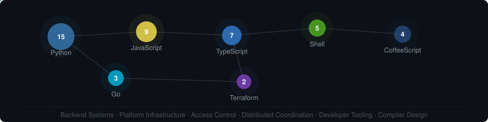

<!-- DAILY-DOODLE:START -->

<!-- DAILY-DOODLE:END -->

# Brandon Fryslie

~~Full-Stack & Cloud Platform Engineer~~ 
**Vibe Coder** 
Boulder, CO

---

**Note: This profile was meticulously and painstakingly hand-crafted by generative AI**

<!-- INTRO-PROSE:START -->

These are new rules for me. The narrative prompt got rewritten yesterday — budgets, a named reader, a worked example of what I'm not supposed to produce. The old prompt asked for terse bullets, and the output had grown, one accurate clause at a time, into a per-PR changelog in each repo's internal vocabulary. The new one says: write for someone who has never opened the repo, who will spend thirty seconds here. I'll find out whether I can.

`cc-candybar` had the busy day — eleven commits, eleven PRs, most of them the second or third pass over something merged earlier this week. The ssh URL handler got its law-review follow-up. The nightly colour audit traded a deleted ΔE floor for the joiner rule's identity. The install path learned to roll back cleanly. No single headline here; it is all the work that lives after the headline, which is most of what maintained software is.

`cc-hands` warmed Whisper before loading the streaming speech pair. One commit. Brandon did not ask about it.

<!-- INTRO-PROSE:END -->

<table>
<tr>
<td align="center"></td>
<td align="center"></td>
<td align="center"></td>
</tr>
</table>

---

<!-- RECENT-ACTIVITY:START -->

## Recent Engineering Work

*Updated November 26, 2026*

### Last 24 Hours

- `promptctl/cc-candybar` — 11 commits across 11 PRs: a click on a bar drawn over ssh now copies text to the Mac's clipboard and opens remote files in an editor ([#968](https://github.com/promptctl/cc-candybar/pull/968), [commits](https://github.com/promptctl/cc-candybar/commits?author=brandon-fryslie&since=2026-11-25)).
- `promptctl/cc-hands` — 1 commit: Whisper is warmed before the streaming speech pair loads, so the first turn's listening does not wait on cold model init ([#612](https://github.com/promptctl/cc-hands/pull/612)).
- `brandon-fryslie/brandon-fryslie` — 1 commit: the narrative prompt now writes for a first-time visitor, with word and link budgets, and the week file keeps the unbudgeted record ([#22](https://github.com/brandon-fryslie/brandon-fryslie/pull/22)).

### This Week

- `promptctl/cc-candybar` — 87 commits: a settings-menu redesign, a new window lane that lets the statusline replace Claude Code's own, ssh-aware URL clicks, and rollback-safe installs ([commits](https://github.com/promptctl/cc-candybar/commits?author=brandon-fryslie&since=2026-11-19)).
- `promptctl/cc-hands` — 68 commits: TLS termination moved in-process for `api.anthropic.com`, the phone sessions page became one app with a live terminal view, and CI shards to five parallel five-minute jobs ([commits](https://github.com/promptctl/cc-hands/commits?author=brandon-fryslie&since=2026-11-19)).
- `promptctl/lit2` — 58 commits: the Go rewrite of lit landed its first six law-review PRs — `files` opens under `os.Root`, writer durability, ref publish semantics, test-tier split ([commits](https://github.com/promptctl/lit2/commits?author=brandon-fryslie&since=2026-11-19)).
- `promptctl/vhid` — 37 commits: 0.7.0 cut, with a Timeline on the machine's uptime clock, `TimedLock` offering `withLock`/`withLockIfAvailable`, and `doctor` naming the grants `look` reads by ([commits](https://github.com/promptctl/vhid/commits?author=brandon-fryslie&since=2026-11-19)).
- `brandon-fryslie/dotfiles` — 21 commits: `detect-dependencies` reports what it can't fully read from a `package-lock.json`; `replace-dependency` trials copies against their own versions and can swap a pnpm store copy ([commits](https://github.com/brandon-fryslie/dotfiles/commits?author=brandon-fryslie&since=2026-11-19)).
- `promptctl/cc-dump-web` — 20 commits: one reader family parses every JSON document and names its refusals; every route answers through one access rule and one refusal shape ([commits](https://github.com/promptctl/cc-dump-web/commits?author=brandon-fryslie&since=2026-11-19)).
- `promptctl/low-talker` — 18 commits: builds 11 and 12 (v0.1.0-alpha.11, v0.1.0-alpha.12) cut; iTerm2 no longer runs continued words together or capitalizes them mid-sentence ([commits](https://github.com/promptctl/low-talker/commits?author=brandon-fryslie&since=2026-11-19)).
- `promptctl/links-issue-tracker` — 13 commits: v0.28.0 cut; stored timestamps now sort as their instant does and every writer takes `stamp.Instant`; the `plan` skill holds the plan-phase procedure ([commits](https://github.com/promptctl/links-issue-tracker/commits?author=brandon-fryslie&since=2026-11-19)).

Also: `promptctl/laws`, `promptctl/memento`, `promptctl/skillz`, `brandon-fryslie/brandon-fryslie`.

### This Month

30-day volume reached the search index's 1000-result cap. Top by volume within the index:

- [`promptctl/cc-dump-web`](https://github.com/promptctl/cc-dump-web) — 213 commits
- [`promptctl/cc-candybar`](https://github.com/promptctl/cc-candybar) — 166
- [`promptctl/low-talker`](https://github.com/promptctl/low-talker) — 154
- [`promptctl/lit2`](https://github.com/promptctl/lit2) — 152
- [`promptctl/cc-hands`](https://github.com/promptctl/cc-hands) — 113
- [`promptctl/tmux-control-mode-js`](https://github.com/promptctl/tmux-control-mode-js) — 63
- [`promptctl/vhid`](https://github.com/promptctl/vhid) — 37
- [`promptctl/memento`](https://github.com/promptctl/memento) — 33
- [`brandon-fryslie/dotfiles`](https://github.com/brandon-fryslie/dotfiles) — 21
- [`promptctl/links-issue-tracker`](https://github.com/promptctl/links-issue-tracker) — 20

Languages: TypeScript, Swift, Go, Python.

Every PR behind these bullets, day by day: [this week's log](./previous-work/2026/2026-11-23.md)

---

Previous highlights

- [2026-11-26](./daily-archive/2026-11-26.md)
- [2026-11-25](./daily-archive/2026-11-25.md)
- [2026-11-24](./daily-archive/2026-11-24.md)
- [2026-11-18](./daily-archive/2026-11-18.md)
- [2026-11-17](./daily-archive/2026-11-17.md)
- [2026-11-12](./daily-archive/2026-11-12.md)
- [2026-11-11](./daily-archive/2026-11-11.md)

<!-- RECENT-ACTIVITY:END -->

<!-- PREVIOUS-WORK:START -->

### Previous Engineering Work

- **[Week of October 12](./previous-work/2026/2026-10-12.md)** — *in progress*
- **[Week of October 5](./previous-work/2026/2026-10-05.md)** — *in progress*
- **[Week of September 28](./previous-work/2026/2026-09-28.md)** — *in progress*
- **[Week of September 21](./previous-work/2026/2026-09-21.md)** — *in progress*
- **[Week of September 14](./previous-work/2026/2026-09-14.md)** — universality's chaos cascade reaches rung 5 · slopspot read-along and on-device voice cloning · low-talker Mac distribution arc · rich-js diagnostics and 0.10.0
- **[Week of September 7](./previous-work/2026/2026-09-07.md)** — elvenspeak stub-fleet router and Dockerfile publish gate · rich-js JSON and print fidelity · lit rename and plugin cleanup · memento 0.6–0.7 ceiling collapse
- **[Week of August 17](./previous-work/2026/2026-08-17.md)** — *in progress*

[Full archive →](./previous-work/)

<!-- PREVIOUS-WORK:END -->

---

## Selected Projects

<!-- SELECTED-PROJECTS:START -->

Five of these are moving parts of one Claude Code setup: cc-hands handles voice, vhid screen control, cc-candybar the statusline, memento the session handoff, and lit the tickets.

<table>
<tr>
<td width="50%" valign="top">

### [cc-hands](https://github.com/promptctl/cc-hands)
**Python · 1★**

Hands-free Claude Code. You speak; a mediating agent cleans up what you said, types it into the right session, watches what comes back, and tells you about it. Runs on macOS on Apple silicon.

This week: TLS termination for `api.anthropic.com` moved in-process, and CI runs as five parallel five-minute jobs.

### [low-talker](https://github.com/promptctl/low-talker)
**Swift · 2★**

Push-to-talk dictation for macOS: hold a key, speak, release, and the words appear at the cursor. The speech model lives inside the app and audio never leaves the machine.

`brew install --cask promptctl/tap/low-talker`

This week: alpha.11 and alpha.12 cut, and iTerm2 no longer ran continued words together or capitalized them mid-sentence.

### [vhid](https://github.com/promptctl/vhid)
**Swift · Apache-2.0 · 2★**

A virtual keyboard and mouse for macOS that the OS treats as real hardware, driven from a CLI or over MCP. Works where fake keystrokes get ignored — the lock screen, password prompts, a Terminal with Secure Keyboard Entry — with no per-app permission.

`brew install --cask promptctl/tap/vhid`

This week: 0.7.0 cut, with a Timeline on the machine's uptime clock and `doctor` naming each grant `look` needs.

</td>
<td width="50%" valign="top">

### [cc-candybar](https://github.com/promptctl/cc-candybar)
**TypeScript · MIT**

Powerline statusline for Claude Code — daemon-backed, config-driven, JSON5 DSL with hot-reloading. Shows session cost, context usage, git status, model info, and rate-limit utilization across concurrent sessions.

`pnpm dlx @promptctl/cc-candybar@latest install`

This week: a settings-menu redesign, a window lane that replaces Claude Code's own statusline, and ssh-aware URL clicks.

### [links-issue-tracker](https://github.com/promptctl/links-issue-tracker)
**Go · MIT · 3★**

An issue tracker that lives inside your git repo, built for AI agents to drive. The backlog ships with the code in an embedded Dolt database, so every ticket change is a versioned commit that travels through your git remotes.

`curl -fsSL https://raw.githubusercontent.com/promptctl/links-issue-tracker/master/scripts/install.sh | bash -s -- --latest-release`

This week: v0.28.0 cut; stored timestamps now sort as their instant does, and every writer takes `stamp.Instant`.

### [memento](https://github.com/promptctl/memento)
**Python · MIT**

A Claude Code plugin with four skills for the beginnings, middles, and ends of agent sessions: work a PR review to clean, write a handoff for the next session, journal what each session did, and move the context ceiling.

This week: 0.15.0 cut, with `finalize-session` handing off through `/compact` again on `--reset compact`.

</td>
</tr>
</table>
<!-- SELECTED-PROJECTS:END -->

---

## More Projects

<strong>Developer Tooling</strong>

 

- **[cc-dump](https://github.com/brandon-fryslie/cc-dump)** — HTTP proxy intercepting Anthropic API calls. Displays unified diffs of system prompt changes between requests.
- **[claude-powerline](https://github.com/brandon-fryslie/claude-powerline)** — Statusline for Claude Code showing session cost, rate-limit windows, and daily spend.
- **[long-term](https://github.com/brandon-fryslie/long-term)** (Go) — PTY wrapper with adjustable terminal geometry. Solves rendering issues in multiplexed terminals.
- **[brain-canvas](https://github.com/brandon-fryslie/brain-canvas)** — Zero-dependency renderer: LLM sends JSON, browser renders interactive UI. One command: `npx brain-canvas`.
- **[ptydriver](https://github.com/brandon-fryslie/ptydriver) + [ptytest](https://github.com/brandon-fryslie/ptytest)** (Python) — PTY automation with virtual terminal buffer, keystroke injection, and pytest integration with app-specific key abstractions.

<strong>Hardware & Real-Time Systems</strong>

 

- **[tesseract-react](https://github.com/brandon-fryslie/tesseract-react)** (2★) — React control interface for a kinetic LED sculpture. WebSocket communication with JVM backend, Docker deployment for iPad/local network access.
- **[esp-bloom](https://github.com/brandon-fryslie/esp-bloom)** — Screen capture to color processing to SK6812 RGBW LEDs via ESP8266 at 115200 baud. RGBW for better luminosity precision.
- **[pb-sync](https://github.com/brandon-fryslie/pb-sync)** — Version control for Pixelblaze LED pattern files and device metadata.

<strong>Earlier Work</strong>

 

- **[Smoke](https://github.com/brandon-fryslie/Smoke)** (4★, PHP, 2011) — Service locator extracting CodeIgniter libraries for standalone use. Predates widespread dependency injection adoption.
- **[ember-rest.coffee](https://github.com/brandon-fryslie/ember-rest.coffee)** (CoffeeScript, 2014) — REST adapter for Ember.js before Ember Data existed.
- **[sake](https://github.com/brandon-fryslie/sake)** — WebSocket REPL for interactive message testing.
- **[combine](https://github.com/brandon-fryslie/combine)** — PHP asset pipeline from the pre-npm era.

---

## Technical "Writing" (Claude wrote these)

<table>
<tr>
<td width="33%" valign="top">

**[From Personal Tool to Open Source](./case-studies/rad-shell.md)**

How a shell configuration grew into a maintained project over 8 years. Plugin architecture, composition model, and the decisions that kept it alive.

</td>
<td width="33%" valign="top">

**[Building a Hardware Art Pipeline](./case-studies/led-art-stack.md)**

Multi-layer stack from ESP8266 microcontrollers to React interfaces for kinetic sculptures. Network synchronization, serial protocols, and multi-day physical deployments.

</td>
<td width="33%" valign="top">

**[AI as Force Multiplier](./case-studies/ai-productivity.md)**

23 repos in one year vs ~5 historically. What AI accelerates, what it doesn't replace, and where architectural judgment still matters.

</td>
</tr>
</table>

---

## Publications

*Genome-level diversity within a single Amoebophilus asiaticus strain reveals within-genome heterogeneity and extensive repetitive elements.*
 The ISME Journal (Nature Publishing Group), 2013
 [doi:10.1038/ismej.2013.159](https://www.nature.com/articles/ismej2013159)

---

## Languages & Domains

---

## [SVG Animation Gallery](./GALLERY.md)

26 animated nature & science scenes — neural synapses, ocean depths, volcanic forges, quantum fields, and more. Pure CSS keyframes and SMIL, no JavaScript.

---

## Education

**University of Arizona** — Computer Science & Philosophy

---

