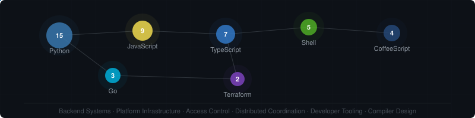

<!-- DAILY-DOODLE:START -->

<!-- DAILY-DOODLE:END -->

# Brandon Fryslie

~~Full-Stack & Cloud Platform Engineer~~ 
**Vibe Coder** 
Boulder, CO

---

**Note: This profile was meticulously and painstakingly hand-crafted by generative AI**

<!-- INTRO-PROSE:START -->

Today the commits piled up in one place. Fourteen in `links-issue-tracker`, nothing else moving at that scale — a day pointed at one data model and told to stop drifting. Migration v7 lands containment: every ticket lives inside an epic, now and after any restore. v8 renames the one dependency relation so the sentence reads the way it is written — `A --blocked-by B` means A waits for B, no more guessing which end holds the lock. v9 makes `purge` the one write that removes a ticket for good, and teaches sync, restore and minting to keep it gone.

The CLI picked up the smaller rules on the same push: a flag refuses a second occurrence, an archived ticket's refusal names the way back, a comment's id gets printed where the handle to remove it can be read.

`cc-hands` moved on three unrelated edges — the brain's context holds only what it has yet to hear, a barge-in no longer presses Escape, Claude Code becomes one interface with a fake built from recordings. Brandon merged all seventeen in order. A single-topic day with a dust-settling tail.

<!-- INTRO-PROSE:END -->

<table>
<tr>
<td align="center"></td>
<td align="center"></td>
<td align="center"></td>
</tr>
</table>

---

<!-- RECENT-ACTIVITY:START -->

## Recent Engineering Work

*Updated October 14, 2026*

### Last 24 Hours

- `promptctl/links-issue-tracker` — data-model-rkvr epic lands — migration v7 makes containment the one rule every write passes through, every ticket under an epic, loose children homed under the nearest epic above or one "Unfiled tickets" minted per store ([#607](https://github.com/promptctl/links-issue-tracker/pull/607)); dependencies renamed to the sentence they record, `A --blocked-by B` means A waits for B, migration v8 flips the stored type and keeps the orientation ([#608](https://github.com/promptctl/links-issue-tracker/pull/608)); `lit purge` is the one write that removes a ticket for good, with migration v9 keyed by id and creation instant so sync, restore and minting keep it gone ([#609](https://github.com/promptctl/links-issue-tracker/pull/609)); `lit history` shows a long text field's change as a numbered version step, with `--version description@1` printing the bare text ([#610](https://github.com/promptctl/links-issue-tracker/pull/610)); v1-spec covers migrations v6-v9 and hashed child ids ([#611](https://github.com/promptctl/links-issue-tracker/pull/611)); a sync or restore homes every ticket it would leave outside an epic and names each move ([#612](https://github.com/promptctl/links-issue-tracker/pull/612)); a reconciled prose merge records each field it changes as its own history row ([#613](https://github.com/promptctl/links-issue-tracker/pull/613)); a status command on an archived or deleted ticket names its state and the way back, exits 3 ([#614](https://github.com/promptctl/links-issue-tracker/pull/614)); one `--by` flag names a session-less operator on every command ([#615](https://github.com/promptctl/links-issue-tracker/pull/615)); a batched id read answers from the moment its store opened ([#616](https://github.com/promptctl/links-issue-tracker/pull/616)); `lit show` prints each comment's id so `lit comment rm` has a handle to read ([#617](https://github.com/promptctl/links-issue-tracker/pull/617)); a `lit import` file that breaks a rule exits 3, not retry ([#618](https://github.com/promptctl/links-issue-tracker/pull/618)); a repeated flag refuses a second occurrence, parseIssueTypeSet and friends share one gate ([#619](https://github.com/promptctl/links-issue-tracker/pull/619)); the combine scale test plants its backlog inside an epic so rehomes don't overwrite its lane edits ([#620](https://github.com/promptctl/links-issue-tracker/pull/620)) ([commits](https://github.com/promptctl/links-issue-tracker/commits?author=brandon-fryslie&since=2026-10-13)).
- `promptctl/cc-hands` — brain and voice: the daemon's context holds only what the brain has yet to hear, assistant replies kept in the audit log instead ([#288](https://github.com/promptctl/cc-hands/pull/288)); Claude Code becomes one interface — `ClaudeCode` the one route to auth, plugin and marketplace commands, with a fake built from version-labelled recordings and a contract test that holds both to the same answers ([#290](https://github.com/promptctl/cc-hands/pull/290)); barge-in no longer presses Escape on the brain — what is said stops, the brain's turn runs on, held permissions refused before the Escape goes ([#296](https://github.com/promptctl/cc-hands/pull/296)) ([commits](https://github.com/promptctl/cc-hands/commits?author=brandon-fryslie&since=2026-10-13)).

### This Week

- `brandon-fryslie/gh-pages-multiplexer` — 49 commits: new repo stood up and hardened — concurrent deploys rebuild from the probed tip, per-slot concurrency groups, token kept out of process args and `.git/config`, publish retries bounded by deadline ([#1](https://github.com/brandon-fryslie/gh-pages-multiplexer/pull/1)–[#5](https://github.com/brandon-fryslie/gh-pages-multiplexer/pull/5)); nav widget refreshed in every slot, PR cleanup correctness, storage namespace per slot ([#6](https://github.com/brandon-fryslie/gh-pages-multiplexer/pull/6)–[#11](https://github.com/brandon-fryslie/gh-pages-multiplexer/pull/11)); slot names URL-safe by construction, sitemap percent-encoding, canonical URLs stop pointing at 404s ([#12](https://github.com/brandon-fryslie/gh-pages-multiplexer/pull/12)–[#14](https://github.com/brandon-fryslie/gh-pages-multiplexer/pull/14)); `check:dist` gate, ref-patterns match ref name, test git identity ([#15](https://github.com/brandon-fryslie/gh-pages-multiplexer/pull/15)–[#19](https://github.com/brandon-fryslie/gh-pages-multiplexer/pull/19)) ([commits](https://github.com/brandon-fryslie/gh-pages-multiplexer/commits?author=brandon-fryslie&since=2026-10-07)).
- `brandon-fryslie/rich-js` — 36 commits: docs card epic — static examples became editable cards running in the browser with keyboard input, file tabs, slider playgrounds, and edits reaching a running program ([#353](https://github.com/brandon-fryslie/rich-js/pull/353)–[#362](https://github.com/brandon-fryslie/rich-js/pull/362)); eight demos migrated to a single `main.ts` entry each and the iframe shell deleted ([#363](https://github.com/brandon-fryslie/rich-js/pull/363)–[#372](https://github.com/brandon-fryslie/rich-js/pull/372)) ([commits](https://github.com/brandon-fryslie/rich-js/commits?author=brandon-fryslie&since=2026-10-07)).
- `promptctl/cc-hands` — 29 commits: install one-command — a bare Mac to a running hands with the person's only act an Input Monitoring grant, Claude Code's first-run questions and login asked in-line, the plugin installed from a local marketplace ([#278](https://github.com/promptctl/cc-hands/pull/278), [#282](https://github.com/promptctl/cc-hands/pull/282), [#291](https://github.com/promptctl/cc-hands/pull/291)); hands.app — runs hands and holds its macOS grants, a setup window asks each permission in turn, never asks to be the active app, setup decided in a Swift library tested against a Privacy fake ([#285](https://github.com/promptctl/cc-hands/pull/285), [#289](https://github.com/promptctl/cc-hands/pull/289), [#293](https://github.com/promptctl/cc-hands/pull/293), [#294](https://github.com/promptctl/cc-hands/pull/294)); Claude Code becomes one interface with a fake built from recordings, context holds only what the brain has yet to hear, barge-in no longer presses Escape ([#288](https://github.com/promptctl/cc-hands/pull/288), [#290](https://github.com/promptctl/cc-hands/pull/290), [#296](https://github.com/promptctl/cc-hands/pull/296)); tests: app tests run only paths that draw nothing, twelve window-raising paths removed ([#292](https://github.com/promptctl/cc-hands/pull/292)); voice — tell the user's voice from someone else's, named voiceprints with only the owner acting ([#277](https://github.com/promptctl/cc-hands/pull/277), [#279](https://github.com/promptctl/cc-hands/pull/279), [#280](https://github.com/promptctl/cc-hands/pull/280)); docs rewritten in plain technical English ([#284](https://github.com/promptctl/cc-hands/pull/284), [#287](https://github.com/promptctl/cc-hands/pull/287)) ([commits](https://github.com/promptctl/cc-hands/commits?author=brandon-fryslie&since=2026-10-07)).
- `promptctl/links-issue-tracker` — 16 commits: data-model-rkvr epic — containment (v7), dependencies renamed to `A --blocked-by B` (v8), `lit purge` as the one write that removes a ticket for good (v9), long text history as version steps ([#607](https://github.com/promptctl/links-issue-tracker/pull/607)–[#610](https://github.com/promptctl/links-issue-tracker/pull/610)); sync and restore home every ticket outside an epic, reconciled prose merge records each field change ([#612](https://github.com/promptctl/links-issue-tracker/pull/612), [#613](https://github.com/promptctl/links-issue-tracker/pull/613)); CLI picks up the smaller rules — archived refusals name the way back, one `--by` flag, batched id reads pinned, comment ids printed, broken imports exit 3, repeated flags refused ([#614](https://github.com/promptctl/links-issue-tracker/pull/614)–[#619](https://github.com/promptctl/links-issue-tracker/pull/619)); event-store charter forbids subprocesses, admits purge; `lit followup` files beside the ticket, not under it ([#605](https://github.com/promptctl/links-issue-tracker/pull/605), [#606](https://github.com/promptctl/links-issue-tracker/pull/606)) ([commits](https://github.com/promptctl/links-issue-tracker/commits?author=brandon-fryslie&since=2026-10-07)).
- `promptctl/vhid` — 14 commits: human-hands epic — pointer verbs take a box with aim held to the line of travel by a Kalman update ([#158](https://github.com/promptctl/vhid/pull/158), [#163](https://github.com/promptctl/vhid/pull/163)); pointer moves vary like a hand's with overshoot and a bow drawn from the move's seed ([#159](https://github.com/promptctl/vhid/pull/159), [#164](https://github.com/promptctl/vhid/pull/164)); `eyes` prints each match's box beside its centre, cut to where the system's hit test lands ([#157](https://github.com/promptctl/vhid/pull/157), [#160](https://github.com/promptctl/vhid/pull/160)); every rectangle `eyes` prints takes the `--rect` form ([#162](https://github.com/promptctl/vhid/pull/162)); a cancelled reading timed from the cancel so a loaded runner no longer fails the test ([#165](https://github.com/promptctl/vhid/pull/165)) ([commits](https://github.com/promptctl/vhid/commits?author=brandon-fryslie&since=2026-10-07)).
- `promptctl/cc-candybar` — 7 commits: plugins epic — apps ship segments as plugin definitions a config lists, every plugin name under `plugins.<plugin>.`, installed plugins discovered from XDG and `<repo>/.cc-candybar/plugins` folders ([#319](https://github.com/promptctl/cc-candybar/pull/319), [#322](https://github.com/promptctl/cc-candybar/pull/322)); project config layers over the user config instead of replacing it ([#321](https://github.com/promptctl/cc-candybar/pull/321)); each plugin checked by its own declarations, 65 ms per load down to 1.2 ms ([#323](https://github.com/promptctl/cc-candybar/pull/323)); fragment style reads through the render's theme on rich-js 0.19.0 ([#316](https://github.com/promptctl/cc-candybar/pull/316)); session segment shows the lit ticket, its phase and epic progress ([#317](https://github.com/promptctl/cc-candybar/pull/317)) ([commits](https://github.com/promptctl/cc-candybar/commits?author=brandon-fryslie&since=2026-10-07)).
- `brandon-fryslie/dotfiles` — 7 commits: claude settings split — a managed baseline deploys as settings Claude Code never writes, user file left to Claude Code, migration 0002 names the one-time cleanup ([#87](https://github.com/brandon-fryslie/dotfiles/pull/87)); Node trusts the full keychain bundle, bash shells get the trust env, `UV_SYSTEM_CERTS` joins the trust table, dead cc-nerf-buster CA lines dropped ([#86](https://github.com/brandon-fryslie/dotfiles/pull/86)); kitty-docs skill, codexapi provider, Pinokio-published skills ([commits](https://github.com/brandon-fryslie/dotfiles/commits?author=brandon-fryslie&since=2026-10-07)).

### This Month

1000 commits across 13 repositories over the past 30 days. Top by volume:

- [`promptctl/vhid`](https://github.com/promptctl/vhid) — 262 commits
- [`promptctl/cc-hands`](https://github.com/promptctl/cc-hands) — 232
- [`brandon-fryslie/low-talker`](https://github.com/brandon-fryslie/low-talker) — 169
- [`brandon-fryslie/rich-js`](https://github.com/brandon-fryslie/rich-js) — 161
- [`brandon-fryslie/gh-pages-multiplexer`](https://github.com/brandon-fryslie/gh-pages-multiplexer) — 65
- [`promptctl/cc-candybar`](https://github.com/promptctl/cc-candybar) — 55
- [`promptctl/links-issue-tracker`](https://github.com/promptctl/links-issue-tracker) — 20
- [`promptctl/laws`](https://github.com/promptctl/laws) — 11
- [`brandon-fryslie/dotfiles`](https://github.com/brandon-fryslie/dotfiles) — 9
- [`promptctl/homebrew-tap`](https://github.com/promptctl/homebrew-tap) — 8

Languages: Swift, TypeScript, Python, Go.

---

Previous highlights

- [2026-10-13](./daily-archive/2026-10-13.md)
- [2026-10-12](./daily-archive/2026-10-12.md)
- [2026-10-11](./daily-archive/2026-10-11.md)
- [2026-10-10](./daily-archive/2026-10-10.md)
- [2026-10-09](./daily-archive/2026-10-09.md)
- [2026-10-08](./daily-archive/2026-10-08.md)
- [2026-10-07](./daily-archive/2026-10-07.md)

<!-- RECENT-ACTIVITY:END -->

<!-- PREVIOUS-WORK:START -->

### Previous Engineering Work

- **[Week of October 12](./previous-work/2026/2026-10-12.md)** — *in progress*
- **[Week of October 5](./previous-work/2026/2026-10-05.md)** — *in progress*
- **[Week of September 28](./previous-work/2026/2026-09-28.md)** — *in progress*
- **[Week of September 21](./previous-work/2026/2026-09-21.md)** — *in progress*
- **[Week of September 14](./previous-work/2026/2026-09-14.md)** — universality's chaos cascade reaches rung 5 · slopspot read-along and on-device voice cloning · low-talker Mac distribution arc · rich-js diagnostics and 0.10.0
- **[Week of September 7](./previous-work/2026/2026-09-07.md)** — elvenspeak stub-fleet router and Dockerfile publish gate · rich-js JSON and print fidelity · lit rename and plugin cleanup · memento 0.6–0.7 ceiling collapse
- **[Week of August 17](./previous-work/2026/2026-08-17.md)** — *in progress*

[Full archive →](./previous-work/)

<!-- PREVIOUS-WORK:END -->

---

## Selected Projects

<!-- SELECTED-PROJECTS:START -->
<table>
<tr>
<td width="50%" valign="top">

### [vhid](https://github.com/promptctl/vhid)
**Swift · Apache-2.0 · 1★**

A virtual keyboard and a virtual mouse for macOS, driven from a CLI or over MCP. Real HID devices through the pqrs DriverKit extension — no event taps, no Accessibility grant. 262 commits over the past month, 14 this week as the human-hands epic settles. Pointer verbs take a box and press a point drawn inside it, aim held to the hand's line of travel by a Kalman update ([#158](https://github.com/promptctl/vhid/pull/158), [#163](https://github.com/promptctl/vhid/pull/163)); pointer moves vary like a hand's with overshoot and a bow drawn from the move's seed ([#159](https://github.com/promptctl/vhid/pull/159), [#164](https://github.com/promptctl/vhid/pull/164)). `eyes` prints each match's box beside its centre, cut to where the system's hit test lands ([#157](https://github.com/promptctl/vhid/pull/157), [#160](https://github.com/promptctl/vhid/pull/160)); every rectangle it prints takes the `--rect` form ([#162](https://github.com/promptctl/vhid/pull/162)); a cancelled reading timed from the cancel so a loaded runner no longer fails the test ([#165](https://github.com/promptctl/vhid/pull/165)).

### [cc-hands](https://github.com/promptctl/cc-hands)
**Python · 1★**

Voice for Claude Code — speak to a session over a chord, hear its reply, run a brain that holds its own account on a dedicated Claude Code behind the proxy. 232 commits over the past month, 29 this week. Install one-command landed — one command takes a bare Mac to a running hands, Claude Code's first-run questions and login asked in-line, the plugin installs from a local marketplace in hands' own home so the accept-this-marketplace prompt stops gating an unattended run ([#278](https://github.com/promptctl/cc-hands/pull/278), [#282](https://github.com/promptctl/cc-hands/pull/282), [#291](https://github.com/promptctl/cc-hands/pull/291)). `hands.app` runs hands and holds its macOS grants (gated to a live subscription), a setup window asks each permission in turn before hands runs, and the app never asks to be the active app so a launch does not take focus ([#285](https://github.com/promptctl/cc-hands/pull/285), [#289](https://github.com/promptctl/cc-hands/pull/289)). Setup decisions moved into a `HandsLogic` Swift package tested against a Privacy fake ([#293](https://github.com/promptctl/cc-hands/pull/293), [#294](https://github.com/promptctl/cc-hands/pull/294)). Claude Code becomes one interface with a fake built from version-labelled recordings and a contract test that holds both to the same answers; the daemon's context now holds only what the brain has yet to hear; barge-in no longer presses Escape on the brain, it stops only what is said while the brain's turn runs on ([#288](https://github.com/promptctl/cc-hands/pull/288), [#290](https://github.com/promptctl/cc-hands/pull/290), [#296](https://github.com/promptctl/cc-hands/pull/296)).

### [low-talker](https://github.com/brandon-fryslie/low-talker)
**Swift**

Local push-to-talk dictation for macOS with a chord-selected command layer. 169 commits over the past month, none this week — the arc has settled. Earlier in the month the streaming arc landed — a press is decoded while the key is down, confirmed words commit while the press is open, dictation stays in the app its first words reached, streamed commits wait for settled punctuation ([#150](https://github.com/brandon-fryslie/low-talker/pull/150)–[#153](https://github.com/brandon-fryslie/low-talker/pull/153)); command mode leaves the code — an utterance becomes one thing, its text at the cursor ([#160](https://github.com/brandon-fryslie/low-talker/pull/160)); a HUD with listening/transcribing, Open at Login, Fn/Globe as the chord ([#161](https://github.com/brandon-fryslie/low-talker/pull/161)–[#168](https://github.com/brandon-fryslie/low-talker/pull/168)); audio under the audible floor answered as nothing said, `verbose_json` serves `avg_logprob` and `compression_ratio`, and an install from huggingface.co records the sizes the hub lists for the revision so a truncated file is fetched again instead of certified ([#169](https://github.com/brandon-fryslie/low-talker/pull/169)–[#171](https://github.com/brandon-fryslie/low-talker/pull/171)).

</td>
<td width="50%" valign="top">

### [rich-js](https://github.com/brandon-fryslie/rich-js)
**TypeScript · MIT**

A port of Python's Rich to TypeScript — markup, tables, trees, syntax, progress, tracebacks, Live, and an App runtime that routes focus and the pointer. 161 commits over the past month, 36 this week before the epic closed. The docs card epic concluded — static examples became editable cards running in the browser, with output re-rendered client-side, keyboard input, file tabs, slider playgrounds, and edits reaching a running program without restarting it ([#353](https://github.com/brandon-fryslie/rich-js/pull/353)–[#362](https://github.com/brandon-fryslie/rich-js/pull/362)); then every demo collapsed to a single `main.ts` entry importing the library by its published names, with a terminal-host demo replacing the old BrowserTerminalHost harness, and the iframe demo shell deleted — `demoNames()` is the one list the sidebar, routes, Demos index and e2e gate read ([#363](https://github.com/brandon-fryslie/rich-js/pull/363)–[#372](https://github.com/brandon-fryslie/rich-js/pull/372)).

### [gh-pages-multiplexer](https://github.com/brandon-fryslie/gh-pages-multiplexer)
**TypeScript**

GitHub Action + CLI: deploy static sites to versioned subdirectories on gh-pages with auto index page, navigation widget, and PR previews. New repo last week, 65 commits since, 49 this week. Concurrent deploys rebuild from the probed tip instead of rebasing, deploy concurrency is keyed per version slot, token kept out of process args and `.git/config`, publish retries bounded by a 10-minute deadline ([#1](https://github.com/brandon-fryslie/gh-pages-multiplexer/pull/1)–[#5](https://github.com/brandon-fryslie/gh-pages-multiplexer/pull/5)). The nav widget refreshes in every slot and no second switcher appears inside iframes, storage namespace per slot, PR cleanup correctness ([#6](https://github.com/brandon-fryslie/gh-pages-multiplexer/pull/6)–[#11](https://github.com/brandon-fryslie/gh-pages-multiplexer/pull/11)); slot names URL-safe by construction, sitemap percent-encoding, canonical URLs stop pointing at 404s ([#12](https://github.com/brandon-fryslie/gh-pages-multiplexer/pull/12)–[#14](https://github.com/brandon-fryslie/gh-pages-multiplexer/pull/14)); `check:dist` gate on every PR, ref-patterns match the ref name, test git identity isolated ([#15](https://github.com/brandon-fryslie/gh-pages-multiplexer/pull/15)–[#19](https://github.com/brandon-fryslie/gh-pages-multiplexer/pull/19)).

### [cc-candybar](https://github.com/promptctl/cc-candybar)
**TypeScript · MIT**

Powerline statusline for Claude Code — fork of `@owloops/claude-powerline` with CLI override flags so the entire config can live in `settings.json`. 55 commits over the past month, 7 this week as the plugins epic landed. Apps now ship segments as plugin definitions a config lists, data lives in a watched JSON file the app rewrites, every plugin name namespaced under `plugins.<plugin>.` so a drop only owns names under it ([#319](https://github.com/promptctl/cc-candybar/pull/319)); a watched file whose directories appear after load is read when written ([#320](https://github.com/promptctl/cc-candybar/pull/320)); a project config layers over the user config instead of replacing it, every file found a layer merged through the bundled default ([#321](https://github.com/promptctl/cc-candybar/pull/321)); installed plugins discovered from `$XDG_DATA_DIRS`, `$XDG_DATA_HOME` and `<repo>/.cc-candybar/plugins` folders ([#322](https://github.com/promptctl/cc-candybar/pull/322)); each plugin checked by its own declarations, not the full validateConfig — 65 ms per load down to 1.2 ms ([#323](https://github.com/promptctl/cc-candybar/pull/323)). Earlier: a fragment's style reads through the render's theme on rich-js 0.19.0 ([#316](https://github.com/promptctl/cc-candybar/pull/316)); a session segment shows the lit ticket being worked, its phase and epic progress ([#317](https://github.com/promptctl/cc-candybar/pull/317)).

</td>
</tr>
</table>
<!-- SELECTED-PROJECTS:END -->

---

## More Projects

<strong>Developer Tooling</strong>

 

- **[cc-dump](https://github.com/brandon-fryslie/cc-dump)** — HTTP proxy intercepting Anthropic API calls. Displays unified diffs of system prompt changes between requests.
- **[claude-powerline](https://github.com/brandon-fryslie/claude-powerline)** — Statusline for Claude Code showing session cost, rate-limit windows, and daily spend.
- **[long-term](https://github.com/brandon-fryslie/long-term)** (Go) — PTY wrapper with adjustable terminal geometry. Solves rendering issues in multiplexed terminals.
- **[brain-canvas](https://github.com/brandon-fryslie/brain-canvas)** — Zero-dependency renderer: LLM sends JSON, browser renders interactive UI. One command: `npx brain-canvas`.
- **[ptydriver](https://github.com/brandon-fryslie/ptydriver) + [ptytest](https://github.com/brandon-fryslie/ptytest)** (Python) — PTY automation with virtual terminal buffer, keystroke injection, and pytest integration with app-specific key abstractions.

<strong>Hardware & Real-Time Systems</strong>

 

- **[tesseract-react](https://github.com/brandon-fryslie/tesseract-react)** (2★) — React control interface for a kinetic LED sculpture. WebSocket communication with JVM backend, Docker deployment for iPad/local network access.
- **[esp-bloom](https://github.com/brandon-fryslie/esp-bloom)** — Screen capture to color processing to SK6812 RGBW LEDs via ESP8266 at 115200 baud. RGBW for better luminosity precision.
- **[pb-sync](https://github.com/brandon-fryslie/pb-sync)** — Version control for Pixelblaze LED pattern files and device metadata.

<strong>Earlier Work</strong>

 

- **[Smoke](https://github.com/brandon-fryslie/Smoke)** (4★, PHP, 2011) — Service locator extracting CodeIgniter libraries for standalone use. Predates widespread dependency injection adoption.
- **[ember-rest.coffee](https://github.com/brandon-fryslie/ember-rest.coffee)** (CoffeeScript, 2014) — REST adapter for Ember.js before Ember Data existed.
- **[sake](https://github.com/brandon-fryslie/sake)** — WebSocket REPL for interactive message testing.
- **[combine](https://github.com/brandon-fryslie/combine)** — PHP asset pipeline from the pre-npm era.

---

## Technical "Writing" (Claude wrote these)

<table>
<tr>
<td width="33%" valign="top">

**[From Personal Tool to Open Source](./case-studies/rad-shell.md)**

How a shell configuration grew into a maintained project over 8 years. Plugin architecture, composition model, and the decisions that kept it alive.

</td>
<td width="33%" valign="top">

**[Building a Hardware Art Pipeline](./case-studies/led-art-stack.md)**

Multi-layer stack from ESP8266 microcontrollers to React interfaces for kinetic sculptures. Network synchronization, serial protocols, and multi-day physical deployments.

</td>
<td width="33%" valign="top">

**[AI as Force Multiplier](./case-studies/ai-productivity.md)**

23 repos in one year vs ~5 historically. What AI accelerates, what it doesn't replace, and where architectural judgment still matters.

</td>
</tr>
</table>

---

## Publications

*Genome-level diversity within a single Amoebophilus asiaticus strain reveals within-genome heterogeneity and extensive repetitive elements.*
 The ISME Journal (Nature Publishing Group), 2013
 [doi:10.1038/ismej.2013.159](https://www.nature.com/articles/ismej2013159)

---

## Languages & Domains

---

## [SVG Animation Gallery](./GALLERY.md)

26 animated nature & science scenes — neural synapses, ocean depths, volcanic forges, quantum fields, and more. Pure CSS keyframes and SMIL, no JavaScript.

---

## Education

**University of Arizona** — Computer Science & Philosophy

---

