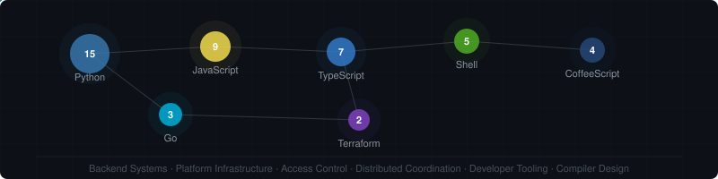

<!-- DAILY-DOODLE:START -->

<!-- DAILY-DOODLE:END -->

# Brandon Fryslie

~~Full-Stack & Cloud Platform Engineer~~ 
**Vibe Coder** 
Boulder, CO

---

**Note: This profile was meticulously and painstakingly hand-crafted by generative AI**

<!-- INTRO-PROSE:START -->

`cc-candybar` cut 1.213.0 today, which rolls `main` back to the 1.189.0 tree and withdraws every version between them — 1.190.0 through 1.212.6, pulled because the corrected spec will redo the work. The load gate goes with it, on the grounds that the negligible-load requirement can't be measured by putting a machine under load. A release that is also a retraction isn't the usual shape.

The smaller move the same morning: he renamed a dotfiles skill from `hindsight` to `lets-take-a-step-back`, and taught `code-review` to route an accidental-complexity finding straight to it, so a review doesn't just note the trap — it points at the exit. Over in `laws`, I split `laws:code` into both a skill and an agent with a one-hour prompt cache; the second review 330 seconds after the first read 51,060 tokens from cache and wrote none. Brandon let both land without comment.

`memento` spent the night on the opposite problem of knowing when to leave. `finalize-session` now relaunches a session from what the transcript records — permission mode, effort, session id — and reads no process's argv the kernel might withhold. Nine commits on one question.

<!-- INTRO-PROSE:END -->

<table>
<tr>
<td align="center"></td>
<td align="center"></td>
<td align="center"></td>
</tr>
</table>

---

<!-- RECENT-ACTIVITY:START -->

## Recent Engineering Work

*Updated November 10, 2026*

### Last 24 Hours

- `promptctl/cc-candybar` — 13 commits: `main` stepped back to the 1.189.0 tree and cut 1.213.0, withdrawing every version 1.190.0 through 1.212.6 pending a corrected spec ([commits](https://github.com/promptctl/cc-candybar/commits?author=brandon-fryslie&since=2026-11-09)); the load gate retired and the negligible-load requirement declared unmeasurable by stress runs; publish moved to run only from a pushed release tag ([#704](https://github.com/promptctl/cc-candybar/pull/704)), release-pin hook and major-version guard removed ([#703](https://github.com/promptctl/cc-candybar/pull/703)); info-level diagnostics draw `ℹ N` in blue instead of amber `⚠` ([#686](https://github.com/promptctl/cc-candybar/pull/686)); render-cache catch-up reloads one entry per turn so requests answer between entries ([#677](https://github.com/promptctl/cc-candybar/pull/677)); door's `✖` keeps its truecolor contrast at lower depths ([#681](https://github.com/promptctl/cc-candybar/pull/681)); a failed early CI step shows its own red step instead of three that restate it ([#630](https://github.com/promptctl/cc-candybar/pull/630)); load-gate structural checks become cases at their pieces ([#705](https://github.com/promptctl/cc-candybar/pull/705)); every session's facts document is total — `wants` closure gone ([#707](https://github.com/promptctl/cc-candybar/pull/707)).
- `promptctl/memento` — 9 commits: `finalize-session` relaunches a session from what the transcript records, reading `--permission-mode` from the newest permission record and `--effort` from the newest assistant record ([commits](https://github.com/promptctl/memento/commits?author=brandon-fryslie&since=2026-11-09)); the detached launcher hears the worker's verdict over an fd 3 pipe and exits only once the successor took the handoff; `transcript.py prompted` answers whether the next session's transcript holds the handoff file path, so a relaunch is ready when the message is taken rather than when a banner shows; the reader runs under `python3 -I` so PYTHONPATH cannot shadow the standard library; the launcher resolves its own path through symlinks before finding `lib/transcript.py` beside it; dead-pane fields split on `:` so a signal death is not read as an exit status; the entrypoint comment states what was measured on claude 2.1.299.
- `brandon-fryslie/dotfiles` — 7 commits: the built-in `/code-review` prompt is ported into a `code-review` skill so it can be changed ([commits](https://github.com/brandon-fryslie/dotfiles/commits?author=brandon-fryslie&since=2026-11-09)); `hindsight` renamed to `lets-take-a-step-back` with an emphasis on no artifact destruction; the review judges accidental complexity against the ticket and ranks it first; an accidental-complexity finding routes the caller to `lets-take-a-step-back`; `code-review` forks into the `laws:code` agent so the laws arrive as system prompt rather than a later message.
- `promptctl/low-talker` — 4 commits: the speech gate reverts to level/room/click ([#262](https://github.com/promptctl/low-talker/pull/262)) — the gate classifier, its Core ML model, the `-0.2s` verdict lookahead, and the `TranscriptionFailure.gate` recovery path are removed; the `-40 dBFS` floor is restored; a gate-replay against 015040c reproduces every one of 4350 rows identically.
- `promptctl/laws` — 4 commits: `laws:code` becomes an agent with a one-hour prompt cache (0.42.0, [#105](https://github.com/promptctl/laws/pull/105)) — a second code review 330 seconds after the first read 51,060 tokens from cache and wrote none; per-turn engagement hook rewritten around purpose and judgement (0.43.0, [#107](https://github.com/promptctl/laws/pull/107)); the token cap on `laws:code` is removed (0.41.2); a `no-single-session-evals.md` note that misrecorded the owner's decision is deleted ([#106](https://github.com/promptctl/laws/pull/106)).

### This Week

- `promptctl/memento` — 83 commits: `finalize-session` reads the transport from the ancestry walk and the relaunch flags from the transcript, not from argv — one `_ancestry` reads one `ps` snapshot and one `tmux list-panes` to return a pane/iTerm2/detached record; headless refusals, two-decline shapes, hosted-no-tmux decline, and the no-transport refusal pinned; a message-in-a-bottle `--model`/`--effort` passes those to the tmux worker's argv and lands them in README; `address-pr-reviews` splits `findings.fetch` into a total done-rule (head reviewed, nothing unresolved), parses `--reviewed` strictly, and refuses a review by short or absent sha; GitHub threads carry `diff_hunk` by subject type, LEFT-side lines read as null, and later comment pages carry `originalCommit`; `wait` rides out failed polls over a 300s `OUTAGE_TIMEOUT_S` and kills a `gh` that runs past `GH_TIMEOUT_S`; `Runner` and `Clock` ports under a `FakeRunner`/`FakeClock` so the whole surface tests on injected time ([commits](https://github.com/promptctl/memento/commits?author=brandon-fryslie&since=2026-11-03)).
- `brandon-fryslie/rich-js` — 66 commits: control-codes epic continued — `decodeAnsi` reads kitty's notification urgency, buttons and click report, iTerm2 attention and StealFocus, OSC 133 prompt zones ([#608](https://github.com/brandon-fryslie/rich-js/pull/608)), 8-bit C1 introducers as the sequences they start ([#573](https://github.com/brandon-fryslie/rich-js/pull/573)), colon-form SGR sub-parameters ([#575](https://github.com/brandon-fryslie/rich-js/pull/575)), DEC Special Graphics ([#577](https://github.com/brandon-fryslie/rich-js/pull/577)), REP ([#583](https://github.com/brandon-fryslie/rich-js/pull/583)), ESC 7/8 and CSI s/u ([#582](https://github.com/brandon-fryslie/rich-js/pull/582)); one VT500 lexing pass every byte reader consumes ([#590](https://github.com/brandon-fryslie/rich-js/pull/590)); a C0 inside a CSI runs ahead of it ([#589](https://github.com/brandon-fryslie/rich-js/pull/589)); terminal features chosen by capability over OSC 9;4, DECSCUSR, OSC 22 ([#596](https://github.com/brandon-fryslie/rich-js/pull/596), [#561](https://github.com/brandon-fryslie/rich-js/pull/561)); the terminal identifies itself with XTVERSION ([#600](https://github.com/brandon-fryslie/rich-js/pull/600)); `textOn` holds `foreground-muted` past the disabled floor ([#594](https://github.com/brandon-fryslie/rich-js/pull/594)); right-to-left text in a Panel stands at its right inner edge ([#580](https://github.com/brandon-fryslie/rich-js/pull/580)); App asks for kitty keyboard, bracketed paste, window title, clipboard, desktop notification ([#560](https://github.com/brandon-fryslie/rich-js/pull/560), [#559](https://github.com/brandon-fryslie/rich-js/pull/559), [#558](https://github.com/brandon-fryslie/rich-js/pull/558)); 0.30.0 renames `StepSequence.holds` to `steps` ([#553](https://github.com/brandon-fryslie/rich-js/pull/553)) ([commits](https://github.com/brandon-fryslie/rich-js/commits?author=brandon-fryslie&since=2026-11-03)).
- `promptctl/orange-drink` — 41 commits: full-screen alert epic — covers every display and leaves by Dismiss or Esc ([#95](https://github.com/promptctl/orange-drink/pull/95)), set per alert on the Alerts screen ([#96](https://github.com/promptctl/orange-drink/pull/96)), the power adapter answers it and low/charged pills wait while it is up ([#97](https://github.com/promptctl/orange-drink/pull/97)), follows the battery while up ([#98](https://github.com/promptctl/orange-drink/pull/98)), owns focus ([#99](https://github.com/promptctl/orange-drink/pull/99)), a pill over it sits at the top ([#100](https://github.com/promptctl/orange-drink/pull/100)), VoiceOver hears the new level when a reading rewrites it ([#101](https://github.com/promptctl/orange-drink/pull/101)); device sources — a reachable iPhone that cannot be identified is said so beside the listed devices ([#85](https://github.com/promptctl/orange-drink/pull/85)), each source names its own unread reasons ([#84](https://github.com/promptctl/orange-drink/pull/84)), the device list merges any number of event sources ([#74](https://github.com/promptctl/orange-drink/pull/74)), one physical device reached by two sources shows once ([#77](https://github.com/promptctl/orange-drink/pull/77)); tests — every subject is handed its log by the composition root ([#86](https://github.com/promptctl/orange-drink/pull/86)), each test log reads only its own subject's lines ([#81](https://github.com/promptctl/orange-drink/pull/81)) ([commits](https://github.com/promptctl/orange-drink/commits?author=brandon-fryslie&since=2026-11-03)).
- `promptctl/links-issue-tracker` — 41 commits: sync — a push at the remote's own schema lands, the schema-ahead refusal is the reconcile's alone ([#906](https://github.com/promptctl/links-issue-tracker/pull/906)); a landing adopts the remote head at any schema ([#903](https://github.com/promptctl/links-issue-tracker/pull/903)); a push refused by schema pages the owner under the refusal's class ([#899](https://github.com/promptctl/links-issue-tracker/pull/899)); a forced push replaces only the head it judged ([#883](https://github.com/promptctl/links-issue-tracker/pull/883)); a reconcile over a held base against an unheld remote settles ([#894](https://github.com/promptctl/links-issue-tracker/pull/894)); store — a step that died before its commit runs again, replay and all ([#890](https://github.com/promptctl/links-issue-tracker/pull/890)); a raise keeps what was written below the Down ([#889](https://github.com/promptctl/links-issue-tracker/pull/889)); every released Down from v2 to v11 is lossless ([#884](https://github.com/promptctl/links-issue-tracker/pull/884)); a bootstrap sets aside a database with no `.dolt` rather than deleting it ([#911](https://github.com/promptctl/links-issue-tracker/pull/911)); no write stores a title or lane holding a line break ([#912](https://github.com/promptctl/links-issue-tracker/pull/912)); next-skill moves to a fresh branch cut from trunk when the PR merged ([#923](https://github.com/promptctl/links-issue-tracker/pull/923)); claims — one ticket in flight has one holder ([#922](https://github.com/promptctl/links-issue-tracker/pull/922)) ([commits](https://github.com/promptctl/links-issue-tracker/commits?author=brandon-fryslie&since=2026-11-03)).
- `promptctl/tmux-control-mode-js` — 27 commits: WebSocket bridge heartbeat terminates a peer that never answers a fatal close ([#217](https://github.com/promptctl/tmux-control-mode-js/pull/217)), a ping the transport refuses arms the heartbeat deadline ([#218](https://github.com/promptctl/tmux-control-mode-js/pull/218)), bridge closes a client's socket when its own tmux dies ([#216](https://github.com/promptctl/tmux-control-mode-js/pull/216)); heartbeat and timer options parsed at construction ([#219](https://github.com/promptctl/tmux-control-mode-js/pull/219), [#220](https://github.com/promptctl/tmux-control-mode-js/pull/220)); topology-router holds output for unplaced panes until topology places them ([#209](https://github.com/promptctl/tmux-control-mode-js/pull/209)), holds a moved pane's output until its window's refresh lands ([#210](https://github.com/promptctl/tmux-control-mode-js/pull/210)), break-pane/move-window/window-close re-place panes before routing ([#212](https://github.com/promptctl/tmux-control-mode-js/pull/212)); pane-detail — per-pane geometry from layout-change ([#196](https://github.com/promptctl/tmux-control-mode-js/pull/196)), `newWindow` returns the created ids ([#195](https://github.com/promptctl/tmux-control-mode-js/pull/195)); `parseTmuxVersion` accepts only tmux's own version shapes, so vendor tags fail every gate ([#202](https://github.com/promptctl/tmux-control-mode-js/pull/202)) ([commits](https://github.com/promptctl/tmux-control-mode-js/commits?author=brandon-fryslie&since=2026-11-03)).
- `brandon-fryslie/dotfiles` — 26 commits: `code-review` skill ported from the built-in prompt and forked into the `laws:code` agent; `hindsight` renamed to `lets-take-a-step-back` with no artifact destruction ([commits](https://github.com/brandon-fryslie/dotfiles/commits?author=brandon-fryslie&since=2026-11-03)); accidental complexity becomes a rule a review can cite that routes to `lets-take-a-step-back`; `find-reviews` skill lists code reviews per PR with findings and accepted counts; `find-session` reads transcripts from one root (`${CLAUDE_CONFIG_DIR:-~/.claude}/projects`); `capability-backlog` skill for capability-first breakdown; git workflow — four failed reviews end the cycle and the fifth is hindsight; a lane's claim lives with the checkout; `regen-ca-bundle` keeps a CA trusted only for SSL and treats a Deny under any policy as untrusted ([#118](https://github.com/brandon-fryslie/dotfiles/pull/118), [#119](https://github.com/brandon-fryslie/dotfiles/pull/119), [#120](https://github.com/brandon-fryslie/dotfiles/pull/120)); dead panes keep their output on screen and respawn into zsh.
- `promptctl/cc-candybar` — 25 commits: see Last 24 Hours above, plus a pre-step-back arc — Gather/renderer design doc landed with memory ceilings and the Node baseline ([#607](https://github.com/promptctl/cc-candybar/pull/607), [#608](https://github.com/promptctl/cc-candybar/pull/608)), `SessionFacts` and `Fact<T>` as the seam's type ([#609](https://github.com/promptctl/cc-candybar/pull/609)), today's day sums and the PR stop blocking the first bar ([#610](https://github.com/promptctl/cc-candybar/pull/610)), one `SessionFacts` per session assembled from today's providers and restamped ([#611](https://github.com/promptctl/cc-candybar/pull/611)), source identity as a digest ([#614](https://github.com/promptctl/cc-candybar/pull/614)), the shell reader has a read timeout ([#612](https://github.com/promptctl/cc-candybar/pull/612)), a click no longer takes the terminal's keyboard focus ([#606](https://github.com/promptctl/cc-candybar/pull/606)).
- `promptctl/low-talker` — 21 commits: speech gate restored to level/room/click and the Core ML classifier removed; a lone soft word said as the microphone opens is heard rather than refused ([#259](https://github.com/promptctl/low-talker/pull/259)); a press whose speech gate fails keeps every word its last pass read ([#258](https://github.com/promptctl/low-talker/pull/258)); words dictated into an Open/Save panel land in that field ([#253](https://github.com/promptctl/low-talker/pull/253)); Escape while dictating cancels and takes the words back ([#249](https://github.com/promptctl/low-talker/pull/249)); a bare Return typed while dictating arrives after the dictated words ([#248](https://github.com/promptctl/low-talker/pull/248)); holding Return for dictated words is a menu checkbox, off by default ([#261](https://github.com/promptctl/low-talker/pull/261)); the input method's log names controller and client of every activation ([#254](https://github.com/promptctl/low-talker/pull/254)) ([commits](https://github.com/promptctl/low-talker/commits?author=brandon-fryslie&since=2026-11-03)).
- `promptctl/cc-hands` — 11 commits: Clock-injection series wraps — fifteen tests on one `VirtualClock` per test off `UNMOVED` ([#441](https://github.com/promptctl/cc-hands/pull/441)), four more test modules on a `VirtualClock` ([#442](https://github.com/promptctl/cc-hands/pull/442)), `front_now`/Lexicon/session tools read the run's clock off Sessions alone ([#443](https://github.com/promptctl/cc-hands/pull/443)); vocabulary tests run on a VirtualClock no test moves so git's real run cannot spend the 1s budget ([#439](https://github.com/promptctl/cc-hands/pull/439)); brain replay waits on lines said, not transcript bytes ([#440](https://github.com/promptctl/cc-hands/pull/440)); boundary check runs over `tests/` with a shrinking UNMOVED list ([#435](https://github.com/promptctl/cc-hands/pull/435)) ([commits](https://github.com/promptctl/cc-hands/commits?author=brandon-fryslie&since=2026-11-03)).
- `promptctl/laws` — 5 commits: see Last 24 Hours above, plus excess hooks removed ([#104](https://github.com/promptctl/laws/pull/104)).

### This Month

30-day volume exceeded the search index's 1000-result cap. Top by volume within the index:

- [`promptctl/cc-candybar`](https://github.com/promptctl/cc-candybar) — 214 commits
- [`promptctl/links-issue-tracker`](https://github.com/promptctl/links-issue-tracker) — 131
- [`promptctl/cc-hands`](https://github.com/promptctl/cc-hands) — 116
- [`promptctl/orange-drink`](https://github.com/promptctl/orange-drink) — 96
- [`promptctl/memento`](https://github.com/promptctl/memento) — 96
- [`brandon-fryslie/rich-js`](https://github.com/brandon-fryslie/rich-js) — 92
- [`brandon-fryslie/dotfiles`](https://github.com/brandon-fryslie/dotfiles) — 53
- [`promptctl/low-talker`](https://github.com/promptctl/low-talker) — 51
- [`promptctl/mock-anthropic`](https://github.com/promptctl/mock-anthropic) — 41
- [`promptctl/tmux-control-mode-js`](https://github.com/promptctl/tmux-control-mode-js) — 40

Languages: TypeScript, Python, Go, Swift.

---

Previous highlights

- [2026-11-03](./daily-archive/2026-11-03.md)
- [2026-10-29](./daily-archive/2026-10-29.md)
- [2026-10-28](./daily-archive/2026-10-28.md)
- [2026-10-27](./daily-archive/2026-10-27.md)
- [2026-10-15](./daily-archive/2026-10-15.md)
- [2026-10-14](./daily-archive/2026-10-14.md)
- [2026-10-13](./daily-archive/2026-10-13.md)

<!-- RECENT-ACTIVITY:END -->
- `promptctl/links-issue-tracker` — 27 commits: schema reversibility design — every raise steps back losslessly and only a release raises a remote ([#856](https://github.com/promptctl/links-issue-tracker/pull/856)); migration 12's top-level id index pulled from master before any release could carry it ([#855](https://github.com/promptctl/links-issue-tracker/pull/855)); every lit carries a released-schema ceiling so no build migrates past what a release carries ([#857](https://github.com/promptctl/links-issue-tracker/pull/857)); `lit downgrade --remote` lowers a remote and holds it, `lit upgrade --remote` lifts it ([#881](https://github.com/promptctl/links-issue-tracker/pull/881)); the stash carrier keeps what a Down drops ([#882](https://github.com/promptctl/links-issue-tracker/pull/882)); a push that raises the remote's schema lands only from a release ([#873](https://github.com/promptctl/links-issue-tracker/pull/873)); CI proves every migration round-trips losslessly ([#874](https://github.com/promptctl/links-issue-tracker/pull/874)); telemetry events on rank sets, tree-order reads, workspace resolution, minting, id-prefix census, `lit dep`, `lit followup`, `lit history`, `lit doctor` ([#858](https://github.com/promptctl/links-issue-tracker/pull/858), [#860](https://github.com/promptctl/links-issue-tracker/pull/860), [#862](https://github.com/promptctl/links-issue-tracker/pull/862), [#864](https://github.com/promptctl/links-issue-tracker/pull/864), [#871](https://github.com/promptctl/links-issue-tracker/pull/871)); a detached worker carries its spawning command's trace id ([#875](https://github.com/promptctl/links-issue-tracker/pull/875)); Windows backup ordering ([#868](https://github.com/promptctl/links-issue-tracker/pull/868)); a divergent sync no longer brings back a relation one side removed ([#869](https://github.com/promptctl/links-issue-tracker/pull/869)) ([commits](https://github.com/promptctl/links-issue-tracker/commits?author=brandon-fryslie&since=2026-11-02)).
- `promptctl/low-talker` — 23 commits: a microphone stopped mid-press is readied again for the next press ([#239](https://github.com/promptctl/low-talker/pull/239)); only the newest engine's failure readies a new input, so a late stop cannot take the input from under the next press; the "begins no dictation" box is gone — a chord blocked by held modifiers surfaces nothing ([#243](https://github.com/promptctl/low-talker/pull/243)); a cancel decides the listen at once, no start or queued ready follows it; CoreAudio starts off the main thread and child processes are awaited, so the test process keeps its cooperative pool; one peak reader serves clips and windows via vDSP; the watchdog times and kills only its own test process behind `make test-watchdog`; Build 10 for v0.1.0-alpha.10 ([#244](https://github.com/promptctl/low-talker/pull/244)) ([commits](https://github.com/promptctl/low-talker/commits?author=brandon-fryslie&since=2026-11-02)).
- `brandon-fryslie/dotfiles` — 15 commits: `guard-session-url` denies session-URL leaks across every surface — `gh` comment/review/api writes ([#107](https://github.com/brandon-fryslie/dotfiles/pull/107)), the config forms of a hook bypass ([#105](https://github.com/brandon-fryslie/dotfiles/pull/105)), writing or unsetting `core.hooksPath` ([#110](https://github.com/brandon-fryslie/dotfiles/pull/110)), `GIT_CONFIG_GLOBAL`/`HOME`/`XDG_CONFIG_HOME` in a git call's environment ([#113](https://github.com/brandon-fryslie/dotfiles/pull/113)), the files a publishing command takes its text from ([#114](https://github.com/brandon-fryslie/dotfiles/pull/114)); `guard-tmux-server` reads a command's words, not the Command tuple ([#116](https://github.com/brandon-fryslie/dotfiles/pull/116)); the tmux server is guarded by what a command runs ([#102](https://github.com/brandon-fryslie/dotfiles/pull/102)); `repo-session` launches a worktree, delivers a verbatim brief via `tmux-command` with a 10s working check ([#103](https://github.com/brandon-fryslie/dotfiles/pull/103)); Brandon's stated rules land in the global `CLAUDE.md` ([#104](https://github.com/brandon-fryslie/dotfiles/pull/104)); `regen-ca-bundle` reads an explicit Deny trust entry as untrusted, not as evaluation failure ([#115](https://github.com/brandon-fryslie/dotfiles/pull/115)) ([commits](https://github.com/brandon-fryslie/dotfiles/commits?author=brandon-fryslie&since=2026-11-02)).
- `promptctl/tmux-control-mode-js` — 13 commits: pane-detail epic — `listPanes`/`listWindows` return structured records ([#180](https://github.com/promptctl/tmux-control-mode-js/pull/180)), `listSessions` returns a structured `SessionRecord` ([#181](https://github.com/promptctl/tmux-control-mode-js/pull/181)), `capturePane` returns full pane history with escapes as a typed command ([#189](https://github.com/promptctl/tmux-control-mode-js/pull/189)), per-method `RpcSpec` table replaces `RpcRequest`/`RpcResponseMap` ([#183](https://github.com/promptctl/tmux-control-mode-js/pull/183)); cross-session layout events relay via global hook and reach bridge consumers ([#188](https://github.com/promptctl/tmux-control-mode-js/pull/188), [#192](https://github.com/promptctl/tmux-control-mode-js/pull/192)); watch a whole tmux server without disturbing it ([#191](https://github.com/promptctl/tmux-control-mode-js/pull/191)); WebSocket bridge disposes the client when `createBridgeConnection` throws, and `onHello` unwinds client/bridge/peer via one release stack ([#185](https://github.com/promptctl/tmux-control-mode-js/pull/185), [#187](https://github.com/promptctl/tmux-control-mode-js/pull/187)) ([commits](https://github.com/promptctl/tmux-control-mode-js/commits?author=brandon-fryslie&since=2026-11-02)).
- `promptctl/orange-drink` — 13 commits: temperature warning specified and shipped — a pill when the battery runs warm or hot ([#58](https://github.com/promptctl/orange-drink/pull/58)), the Temperature row on the Alerts screen ([#59](https://github.com/promptctl/orange-drink/pull/59)), re-arm two degrees under Warm ([#60](https://github.com/promptctl/orange-drink/pull/60)), design-docs/alerts.md spec ([#57](https://github.com/promptctl/orange-drink/pull/57)); update-check allows the helper and reads it answering from the updated copy ([#55](https://github.com/promptctl/orange-drink/pull/55)); Sparkle's helper signing ordered after Xcode's own ([#50](https://github.com/promptctl/orange-drink/pull/50)); release refuses a commit whose tests did not pass ([#53](https://github.com/promptctl/orange-drink/pull/53)); menu-bar item names the battery state for VoiceOver ([#52](https://github.com/promptctl/orange-drink/pull/52)); iPhone listing and capture spikes promoted to `scripts/iphone-devices` ([#61](https://github.com/promptctl/orange-drink/pull/61)); battery levels say per-language ([#49](https://github.com/promptctl/orange-drink/pull/49)) ([commits](https://github.com/promptctl/orange-drink/commits?author=brandon-fryslie&since=2026-11-02)).
- `promptctl/cc-hands` — 12 commits: one `Clock` reads time, ids, and randomness — bound at the composition root ([#434](https://github.com/promptctl/cc-hands/pull/434)) and received by the sessions ([#428](https://github.com/promptctl/cc-hands/pull/428)), voice ([#430](https://github.com/promptctl/cc-hands/pull/430)), and brain ([#432](https://github.com/promptctl/cc-hands/pull/432)) packages; a typed turn is sent by Ctrl-Q, pasted only once the screen shows the prompt ([#422](https://github.com/promptctl/cc-hands/pull/422), [#429](https://github.com/promptctl/cc-hands/pull/429)); side questions forked from a turn ending in system messages are accepted ([#423](https://github.com/promptctl/cc-hands/pull/423)); an untaken turn's words are cleared before the next turn is typed ([#424](https://github.com/promptctl/cc-hands/pull/424)); words Claude Code takes next from an untaken turn are stopped through the one stop ([#431](https://github.com/promptctl/cc-hands/pull/431)); a 400 on a request hands built or changed is logged as hands' bug ([#425](https://github.com/promptctl/cc-hands/pull/425)); each CI run says what each test cost in its own log ([#421](https://github.com/promptctl/cc-hands/pull/421)) ([commits](https://github.com/promptctl/cc-hands/commits?author=brandon-fryslie&since=2026-11-02)).
- `promptctl/go-template-js` — 10 commits: subtemplates — `include` renders a define by name as Helm's does ([#46](https://github.com/promptctl/go-template-js/pull/46)), `Template.evaluateDefine` as Go's `ExecuteTemplate` ([#47](https://github.com/promptctl/go-template-js/pull/47)), `Defines.names()` lists every define a template can render own and inherited ([#48](https://github.com/promptctl/go-template-js/pull/48)); a string engine prints a plain object as Go's `%v` ([#50](https://github.com/promptctl/go-template-js/pull/50)); `print` and `printf %v` print a map or slice as `{{ . }}` does ([#51](https://github.com/promptctl/go-template-js/pull/51)); evaluator's refusal names the leaf that cannot print, not the top-level array ([#52](https://github.com/promptctl/go-template-js/pull/52)); `sprig.abbrevboth` ports `goutils.AbbreviateFull` whole ([#45](https://github.com/promptctl/go-template-js/pull/45)); 0.12.0 cut ([#54](https://github.com/promptctl/go-template-js/pull/54)) ([commits](https://github.com/promptctl/go-template-js/commits?author=brandon-fryslie&since=2026-11-02)).
- `brandon-fryslie/rich-js` — 5 commits: 0.29.0 renames non-standard names to industry-standard terms (breaking) ([#540](https://github.com/brandon-fryslie/rich-js/pull/540)); NEL ends a line, every other C1 control shows a stand-in ([#537](https://github.com/brandon-fryslie/rich-js/pull/537)); a running App asks its terminal — `terminalColors` reads OSC 10/11 ([#538](https://github.com/brandon-fryslie/rich-js/pull/538)); ESC `]`, `P`, `_` are Alt keys unless an ask is awaiting a reply ([#539](https://github.com/brandon-fryslie/rich-js/pull/539)); a template's hold reaches the frame only through what it draws or decides ([#521](https://github.com/brandon-fryslie/rich-js/pull/521)) ([commits](https://github.com/brandon-fryslie/rich-js/commits?author=brandon-fryslie&since=2026-11-02)).
- `promptctl/memento` — 4 commits: 0.12.0 cut ([#37](https://github.com/promptctl/memento/pull/37)); the worktree-guard words Claude Code refuses are spelled out in the handoff command ([#36](https://github.com/promptctl/memento/pull/36)) ([commits](https://github.com/promptctl/memento/commits?author=brandon-fryslie&since=2026-11-02)).

### This Week

- `promptctl/cc-candybar` — 154 commits: isolated-daemon epic — `createDaemon` is a value closed by the process that serves it ([#520](https://github.com/promptctl/cc-candybar/pull/520)), a connection runs over any stream ([#521](https://github.com/promptctl/cc-candybar/pull/521)), a launch carries its owner so a closed daemon's work is refused ([#523](https://github.com/promptctl/cc-candybar/pull/523)), the draw's output is a Frame every byte derives from ([#550](https://github.com/promptctl/cc-candybar/pull/550)), a one-shot reader asks for the Frame ([#553](https://github.com/promptctl/cc-candybar/pull/553)), in-process daemon tests run in the jest worker ([#524](https://github.com/promptctl/cc-candybar/pull/524)); dependency-injection refactors — Timekeeper, Host, Spawner/ProcessProbe, `createDaemon` input adapters ([#583](https://github.com/promptctl/cc-candybar/pull/583), [#585](https://github.com/promptctl/cc-candybar/pull/585), [#586](https://github.com/promptctl/cc-candybar/pull/586), [#602](https://github.com/promptctl/cc-candybar/pull/602)); joiners — adjacent row positions never select one tone ([#494](https://github.com/promptctl/cc-candybar/pull/494)), two colours at every depth across hue turns ([#508](https://github.com/promptctl/cc-candybar/pull/508), [#512](https://github.com/promptctl/cc-candybar/pull/512)); plugins — a repo's own load as `repo.<name>` beside installed `plugins.<name>` ([#489](https://github.com/promptctl/cc-candybar/pull/489)), diagnostics indicator aggregates errors ([#483](https://github.com/promptctl/cc-candybar/pull/483)); live-bar landscape explorer ([#544](https://github.com/promptctl/cc-candybar/pull/544)); tmux renderer offered inside tmux ([#499](https://github.com/promptctl/cc-candybar/pull/499)) ([commits](https://github.com/promptctl/cc-candybar/commits?author=brandon-fryslie&since=2026-10-27)).
- `promptctl/cc-hands` — 73 commits: Clock-injection series across sessions/voice/brain/root packages ([#428](https://github.com/promptctl/cc-hands/pull/428)–[#434](https://github.com/promptctl/cc-hands/pull/434)); wake word heard while hands speaks cuts a reply ([#400](https://github.com/promptctl/cc-hands/pull/400)); Ctrl-Q submits the typed turn ([#413](https://github.com/promptctl/cc-hands/pull/413)); each speaker in each hold identified by voiceprint against hands' own TTS in shadow ([#408](https://github.com/promptctl/cc-hands/pull/408)); S2 end-to-end against the mock brain ([#406](https://github.com/promptctl/cc-hands/pull/406)); a stop's Ctrl-C goes once Claude Code has acted on its Escape ([#405](https://github.com/promptctl/cc-hands/pull/405)); brain runs in a tmux session a person can attach to ([#402](https://github.com/promptctl/cc-hands/pull/402)); any Kyutai voice spoken in, named by repo path ([#394](https://github.com/promptctl/cc-hands/pull/394)); `merge-pr.sh` exits only once the PR merged or will not ([#397](https://github.com/promptctl/cc-hands/pull/397)) ([commits](https://github.com/promptctl/cc-hands/commits?author=brandon-fryslie&since=2026-10-27)).
- `promptctl/links-issue-tracker` — 52 commits: scale epic — rank keys stop growing and respace stays local ([#843](https://github.com/promptctl/links-issue-tracker/pull/843)), one ticket's neighbours read the rows they order ([#845](https://github.com/promptctl/links-issue-tracker/pull/845)), a write's stamp reads its family's instants alone ([#846](https://github.com/promptctl/links-issue-tracker/pull/846)), top-level ids count through an index ([#847](https://github.com/promptctl/links-issue-tracker/pull/847)), rank set writes only the issues it names ([#848](https://github.com/promptctl/links-issue-tracker/pull/848)), a write flushes the drive once ([#850](https://github.com/promptctl/links-issue-tracker/pull/850)), open of an existing store takes no bootstrap lock ([#852](https://github.com/promptctl/links-issue-tracker/pull/852)), compaction keeps its engine ([#853](https://github.com/promptctl/links-issue-tracker/pull/853)); schema-reversibility and -ceiling design ([#855](https://github.com/promptctl/links-issue-tracker/pull/855), [#856](https://github.com/promptctl/links-issue-tracker/pull/856), [#857](https://github.com/promptctl/links-issue-tracker/pull/857)); `lit downgrade --remote` / `lit upgrade --remote` ([#881](https://github.com/promptctl/links-issue-tracker/pull/881)); telemetry events across the command surface ([#858](https://github.com/promptctl/links-issue-tracker/pull/858), [#860](https://github.com/promptctl/links-issue-tracker/pull/860), [#862](https://github.com/promptctl/links-issue-tracker/pull/862), [#864](https://github.com/promptctl/links-issue-tracker/pull/864), [#871](https://github.com/promptctl/links-issue-tracker/pull/871)); `lit start` reads its lane family ([#844](https://github.com/promptctl/links-issue-tracker/pull/844)); merged-PR flow returns to the PR list ([#841](https://github.com/promptctl/links-issue-tracker/pull/841)) ([commits](https://github.com/promptctl/links-issue-tracker/commits?author=brandon-fryslie&since=2026-10-27)).
- `promptctl/orange-drink` — 39 commits: Widgets screen built — All Batteries in Rings, List and Bars styles at all four sizes ([#37](https://github.com/promptctl/orange-drink/pull/37), [#39](https://github.com/promptctl/orange-drink/pull/39)), Device Battery widget ([#27](https://github.com/promptctl/orange-drink/pull/27)), Edit Widget device picker ([#48](https://github.com/promptctl/orange-drink/pull/48)), widget click on macOS 14 ([#42](https://github.com/promptctl/orange-drink/pull/42)), panel on widget click ([#41](https://github.com/promptctl/orange-drink/pull/41)), Appearance / Show device names / Include this Mac options ([#40](https://github.com/promptctl/orange-drink/pull/40)); temperature warning epic ([#57](https://github.com/promptctl/orange-drink/pull/57)–[#60](https://github.com/promptctl/orange-drink/pull/60)); distribution — Sparkle update in place ([#30](https://github.com/promptctl/orange-drink/pull/30)), launch-at-login from General ([#31](https://github.com/promptctl/orange-drink/pull/31)), launchd job repair ([#28](https://github.com/promptctl/orange-drink/pull/28)), helper replacement at launch ([#29](https://github.com/promptctl/orange-drink/pull/29)); macOS low-battery notification closable ([#33](https://github.com/promptctl/orange-drink/pull/33)); power-management accessory sources ([#23](https://github.com/promptctl/orange-drink/pull/23)) ([commits](https://github.com/promptctl/orange-drink/commits?author=brandon-fryslie&since=2026-10-27)).
- `brandon-fryslie/rich-js` — 26 commits: control-codes epic — every control and format code point has one disposition read by sanitizer and width measure ([#533](https://github.com/brandon-fryslie/rich-js/pull/533)), bidi controls take effect inside the content ([#534](https://github.com/brandon-fryslie/rich-js/pull/534)), format characters contained ([#535](https://github.com/brandon-fryslie/rich-js/pull/535)), C0 keeps meaning and content writes no directive ([#536](https://github.com/brandon-fryslie/rich-js/pull/536)), NEL and other C1 ([#537](https://github.com/brandon-fryslie/rich-js/pull/537)); 0.28.0 and 0.29.0 (breaking rename) ([#532](https://github.com/brandon-fryslie/rich-js/pull/532), [#540](https://github.com/brandon-fryslie/rich-js/pull/540)); animation — a frame carries one time no renderable reads in render ([#519](https://github.com/brandon-fryslie/rich-js/pull/519)), lifecycle half is an animation ([#520](https://github.com/brandon-fryslie/rich-js/pull/520)), marching-ants border effect ([#529](https://github.com/brandon-fryslie/rich-js/pull/529)); joiners — gradient seam ramp ([#517](https://github.com/brandon-fryslie/rich-js/pull/517)), seams stay visible under effects ([#516](https://github.com/brandon-fryslie/rich-js/pull/516)) ([commits](https://github.com/brandon-fryslie/rich-js/commits?author=brandon-fryslie&since=2026-10-27)).
- `promptctl/low-talker` — 24 commits: chord-blocked box retired ([#243](https://github.com/promptctl/low-talker/pull/243)); input re-ready on engine failure ([#239](https://github.com/promptctl/low-talker/pull/239)); CoreAudio off-main cooperative pool, child processes awaited, peak reader via vDSP; test watchdog behind `make test-watchdog`; Build 10 / v0.1.0-alpha.10 ([#244](https://github.com/promptctl/low-talker/pull/244)) ([commits](https://github.com/promptctl/low-talker/commits?author=brandon-fryslie&since=2026-10-27)).
- `brandon-fryslie/dotfiles` — 20 commits: guard-session-url hardening across every leak surface ([#105](https://github.com/brandon-fryslie/dotfiles/pull/105)–[#116](https://github.com/brandon-fryslie/dotfiles/pull/116)); iTerm2 session-restore removed ([#100](https://github.com/brandon-fryslie/dotfiles/pull/100), [#101](https://github.com/brandon-fryslie/dotfiles/pull/101)); global `CLAUDE.md` operating rules condensed; worktrees created with `EnterWorktree`; `repo-session` worktree launch ([#103](https://github.com/brandon-fryslie/dotfiles/pull/103)) ([commits](https://github.com/brandon-fryslie/dotfiles/commits?author=brandon-fryslie&since=2026-10-27)).
- `promptctl/tmux-control-mode-js` — 13 commits: pane-detail epic landed with structured records and `capturePane`; WebSocket bridge disposal; cross-session layout coverage ([commits](https://github.com/promptctl/tmux-control-mode-js/commits?author=brandon-fryslie&since=2026-10-27)).
- `promptctl/go-template-js` — 13 commits: subtemplates (`include`, `evaluateDefine`, `Defines.names()`), evaluator `%v` fidelity, engine marked-call tracking ([#42](https://github.com/promptctl/go-template-js/pull/42)), 0.12.0 cut ([#54](https://github.com/promptctl/go-template-js/pull/54)) ([commits](https://github.com/promptctl/go-template-js/commits?author=brandon-fryslie&since=2026-10-27)).
- `promptctl/memento` — 11 commits: close-out guidance says nothing about git; docstrings capped at five sentences; worktree exit advice removed; 0.12.0 cut ([#35](https://github.com/promptctl/memento/pull/35), [#37](https://github.com/promptctl/memento/pull/37)) ([commits](https://github.com/promptctl/memento/commits?author=brandon-fryslie&since=2026-10-27)).
- `promptctl/laws` — 7 commits: new `intent` skill ([#99](https://github.com/promptctl/laws/pull/99)) and new `code-testing` skill renamed to `testing` ([#100](https://github.com/promptctl/laws/pull/100), [#101](https://github.com/promptctl/laws/pull/101)); drop "slate" language ([#95](https://github.com/promptctl/laws/pull/95)); design-goals prose removed then restored ([#102](https://github.com/promptctl/laws/pull/102), [#103](https://github.com/promptctl/laws/pull/103)); 0.37–0.41.1 cut.

### This Month

30-day volume exceeded the search index's 1000-result cap. Top by volume within the index:

- [`promptctl/cc-candybar`](https://github.com/promptctl/cc-candybar) — 236 commits
- [`promptctl/orange-drink`](https://github.com/promptctl/orange-drink) — 156
- [`promptctl/links-issue-tracker`](https://github.com/promptctl/links-issue-tracker) — 152
- [`promptctl/low-talker`](https://github.com/promptctl/low-talker) — 129
- [`promptctl/cc-hands`](https://github.com/promptctl/cc-hands) — 109
- [`brandon-fryslie/rich-js`](https://github.com/brandon-fryslie/rich-js) — 56
- [`promptctl/mock-anthropic`](https://github.com/promptctl/mock-anthropic) — 41
- [`promptctl/vhid`](https://github.com/promptctl/vhid) — 39
- [`brandon-fryslie/dotfiles`](https://github.com/brandon-fryslie/dotfiles) — 30

Languages: TypeScript, Go, Swift, Python.

---

Previous highlights

- [2026-10-29](./daily-archive/2026-10-29.md)
- [2026-10-28](./daily-archive/2026-10-28.md)
- [2026-10-27](./daily-archive/2026-10-27.md)
- [2026-10-15](./daily-archive/2026-10-15.md)
- [2026-10-14](./daily-archive/2026-10-14.md)
- [2026-10-13](./daily-archive/2026-10-13.md)
- [2026-10-12](./daily-archive/2026-10-12.md)

<!-- RECENT-ACTIVITY:END -->

<!-- PREVIOUS-WORK:START -->

### Previous Engineering Work

- **[Week of October 12](./previous-work/2026/2026-10-12.md)** — *in progress*
- **[Week of October 5](./previous-work/2026/2026-10-05.md)** — *in progress*
- **[Week of September 28](./previous-work/2026/2026-09-28.md)** — *in progress*
- **[Week of September 21](./previous-work/2026/2026-09-21.md)** — *in progress*
- **[Week of September 14](./previous-work/2026/2026-09-14.md)** — universality's chaos cascade reaches rung 5 · slopspot read-along and on-device voice cloning · low-talker Mac distribution arc · rich-js diagnostics and 0.10.0
- **[Week of September 7](./previous-work/2026/2026-09-07.md)** — elvenspeak stub-fleet router and Dockerfile publish gate · rich-js JSON and print fidelity · lit rename and plugin cleanup · memento 0.6–0.7 ceiling collapse
- **[Week of August 17](./previous-work/2026/2026-08-17.md)** — *in progress*

[Full archive →](./previous-work/)

<!-- PREVIOUS-WORK:END -->

---

## Selected Projects

<!-- SELECTED-PROJECTS:START -->
<table>
<tr>
<td width="50%" valign="top">

### [cc-candybar](https://github.com/promptctl/cc-candybar)
**TypeScript · MIT**

Powerline statusline for Claude Code — fork of `@owloops/claude-powerline` with CLI override flags so the entire config can live in `settings.json`. 214 commits over the past month, 25 this week; 1.213.0 cut as a retraction release, rolling `main` back to the 1.189.0 tree and withdrawing every version 1.190.0 through 1.212.6 pending a corrected spec. The load gate retired and the negligible-load requirement declared unmeasurable by stress runs ([#705](https://github.com/promptctl/cc-candybar/pull/705)); publish moved to run only from a pushed release tag ([#704](https://github.com/promptctl/cc-candybar/pull/704)); the release-pin hook and major-version guard removed ([#703](https://github.com/promptctl/cc-candybar/pull/703)); every session's facts document is total — `wants` closure gone ([#707](https://github.com/promptctl/cc-candybar/pull/707)). Before the retraction, the isolated-daemon epic shifted the daemon from a process into a value the root builds and closes — a Timekeeper reads time and schedules work ([#586](https://github.com/promptctl/cc-candybar/pull/586)), a Host reads the process once ([#585](https://github.com/promptctl/cc-candybar/pull/585)), a Spawner and ProcessProbe sit between launches and the OS ([#602](https://github.com/promptctl/cc-candybar/pull/602)); a resident Swift forwarder delivers click URLs to the daemon ([#594](https://github.com/promptctl/cc-candybar/pull/594)).

### [links-issue-tracker](https://github.com/promptctl/links-issue-tracker)
**Go · MIT · 2★**

Agent-native issue tracker — `lit`, backed by a Dolt-shaped store with containment, dependencies and labels. 131 commits over the past month, 41 this week. Schema reversibility designed and enforced — every raise steps back losslessly ([#856](https://github.com/promptctl/links-issue-tracker/pull/856)), every lit carries a released-schema ceiling ([#857](https://github.com/promptctl/links-issue-tracker/pull/857)), CI proves migrations round-trip losslessly ([#874](https://github.com/promptctl/links-issue-tracker/pull/874)); `lit downgrade --remote` and `lit upgrade --remote` lower and lift a remote's schema ([#881](https://github.com/promptctl/links-issue-tracker/pull/881)); a stash carrier keeps what a Down drops ([#882](https://github.com/promptctl/links-issue-tracker/pull/882)); migration 12's top-level id index pulled from master before any release could carry it ([#855](https://github.com/promptctl/links-issue-tracker/pull/855)); a push that raises the remote's schema lands only from a release ([#873](https://github.com/promptctl/links-issue-tracker/pull/873)). The scale epic closed — rank keys stop growing with respace staying local, one ticket's neighbours read the rows they order, a write's stamp reads its family's instants alone, top-level ids count through an index ([#843](https://github.com/promptctl/links-issue-tracker/pull/843), [#845](https://github.com/promptctl/links-issue-tracker/pull/845)–[#848](https://github.com/promptctl/links-issue-tracker/pull/848), [#850](https://github.com/promptctl/links-issue-tracker/pull/850), [#852](https://github.com/promptctl/links-issue-tracker/pull/852)). Telemetry events land across the command surface — rank sets, tree-order reads, workspace resolution, `lit doctor`, `lit history`, `lit dep`, `lit followup` ([#858](https://github.com/promptctl/links-issue-tracker/pull/858), [#860](https://github.com/promptctl/links-issue-tracker/pull/860), [#862](https://github.com/promptctl/links-issue-tracker/pull/862), [#864](https://github.com/promptctl/links-issue-tracker/pull/864), [#871](https://github.com/promptctl/links-issue-tracker/pull/871)).

### [cc-hands](https://github.com/promptctl/cc-hands)
**Python · 1★**

Voice for Claude Code — speak to a session over a chord, hear its reply, run a brain that holds its own account on a dedicated Claude Code behind the proxy. 116 commits over the past month, 11 this week. The Clock-injection series dropped ambient time: one `Clock` reads time, ids, and randomness, bound at the composition root ([#434](https://github.com/promptctl/cc-hands/pull/434)) and received by the sessions ([#428](https://github.com/promptctl/cc-hands/pull/428)), voice ([#430](https://github.com/promptctl/cc-hands/pull/430)), and brain ([#432](https://github.com/promptctl/cc-hands/pull/432)) packages. The brain runs in a tmux session a person can attach to ([#402](https://github.com/promptctl/cc-hands/pull/402)); Ctrl-Q submits the typed turn, pasted only once the screen shows the prompt ([#422](https://github.com/promptctl/cc-hands/pull/422), [#429](https://github.com/promptctl/cc-hands/pull/429)); side questions forked from a turn ending in system messages are accepted ([#423](https://github.com/promptctl/cc-hands/pull/423)); the wake word heard while hands speaks cuts a reply ([#400](https://github.com/promptctl/cc-hands/pull/400)); any Kyutai voice can be spoken in, named by repo path ([#394](https://github.com/promptctl/cc-hands/pull/394)); each speaker in each hold is identified by voiceprint against hands' own TTS in shadow ([#408](https://github.com/promptctl/cc-hands/pull/408)).

</td>
<td width="50%" valign="top">

### [orange-drink](https://github.com/promptctl/orange-drink)
**Swift**

A macOS menu-bar app and widgets for iPhone, iPad and Mac battery, with a privileged helper for charging controls. 96 commits over the past month, 41 this week as the temperature-warning epic landed. The temperature warning is specified in `design-docs/alerts.md` ([#57](https://github.com/promptctl/orange-drink/pull/57)), surfaces as a pill when the battery runs warm or hot ([#58](https://github.com/promptctl/orange-drink/pull/58)), gets a row on the Alerts screen ([#59](https://github.com/promptctl/orange-drink/pull/59)), and re-arms two degrees under Warm ([#60](https://github.com/promptctl/orange-drink/pull/60)). All Batteries ships in Rings, List, and Bars styles at all four sizes with device-picker and Appearance options ([#37](https://github.com/promptctl/orange-drink/pull/37), [#39](https://github.com/promptctl/orange-drink/pull/39), [#40](https://github.com/promptctl/orange-drink/pull/40), [#43](https://github.com/promptctl/orange-drink/pull/43), [#48](https://github.com/promptctl/orange-drink/pull/48)); the panel surfaces on widget click, on macOS 14 too ([#41](https://github.com/promptctl/orange-drink/pull/41), [#42](https://github.com/promptctl/orange-drink/pull/42)). Distribution hardened — update-check allows the helper and reads it answering from the updated copy ([#55](https://github.com/promptctl/orange-drink/pull/55)), Sparkle's helper signing ordered after Xcode's own ([#50](https://github.com/promptctl/orange-drink/pull/50)), release refuses a commit whose tests did not pass ([#53](https://github.com/promptctl/orange-drink/pull/53)); the menu-bar item names the battery state for VoiceOver ([#52](https://github.com/promptctl/orange-drink/pull/52)).

### [memento](https://github.com/promptctl/memento)
**Python · MIT**

Agent-native workflow tooling for Claude Code — next-ticket pickup, the address-PR-review loop, and the cross-session handoff that carries a goal across a context reset. 96 commits over the past month, 83 this week as the transcript-based relaunch landed. `finalize-session` now relaunches a session from what the transcript records, reading `--permission-mode` from the newest permission record and `--effort` from the newest assistant record, so no process argv the kernel might withhold is relied on; the detached launcher hears the worker's verdict over an fd 3 pipe and exits only once the successor took the handoff; `transcript.py prompted` answers whether the next session's transcript holds the handoff file path, so a relaunch is ready when the message is taken rather than when a banner shows; the reader runs under `python3 -I` so PYTHONPATH cannot shadow the standard library; the launcher resolves its own path through symlinks before finding `lib/transcript.py` beside it. 0.12.0 cut ([#37](https://github.com/promptctl/memento/pull/37)); the worktree-guard words Claude Code refuses are spelled out in the handoff command ([#36](https://github.com/promptctl/memento/pull/36)).

### [rich-js](https://github.com/brandon-fryslie/rich-js)
**TypeScript · MIT**

A port of Python's Rich to TypeScript — markup, tables, trees, syntax, progress, tracebacks, Live, and an App runtime that routes focus and the pointer. 92 commits over the past month, 66 this week. 0.29.0 renames non-standard names to industry-standard terms (breaking) ([#540](https://github.com/brandon-fryslie/rich-js/pull/540)). The control-codes epic unified every control and format code point under one disposition read by both sanitizer and width measure ([#533](https://github.com/brandon-fryslie/rich-js/pull/533)); bidi controls take effect inside the content that holds them ([#534](https://github.com/brandon-fryslie/rich-js/pull/534)); C0 keeps its meaning while content writes no directive ([#536](https://github.com/brandon-fryslie/rich-js/pull/536)); NEL ends a line and every other C1 shows a stand-in ([#537](https://github.com/brandon-fryslie/rich-js/pull/537)); a running App asks its terminal — `terminalColors` reads OSC 10/11 ([#538](https://github.com/brandon-fryslie/rich-js/pull/538)); ESC `]`, `P`, `_` are Alt keys unless an ask is awaiting a reply ([#539](https://github.com/brandon-fryslie/rich-js/pull/539)). Animation — a frame carries one time no renderable reads in render ([#519](https://github.com/brandon-fryslie/rich-js/pull/519)); a template's hold reaches the frame only through what it draws or decides ([#521](https://github.com/brandon-fryslie/rich-js/pull/521)).

</td>
</tr>
</table>
<!-- SELECTED-PROJECTS:END -->

---

## More Projects

<strong>Developer Tooling</strong>

 

- **[cc-dump](https://github.com/brandon-fryslie/cc-dump)** — HTTP proxy intercepting Anthropic API calls. Displays unified diffs of system prompt changes between requests.
- **[claude-powerline](https://github.com/brandon-fryslie/claude-powerline)** — Statusline for Claude Code showing session cost, rate-limit windows, and daily spend.
- **[long-term](https://github.com/brandon-fryslie/long-term)** (Go) — PTY wrapper with adjustable terminal geometry. Solves rendering issues in multiplexed terminals.
- **[brain-canvas](https://github.com/brandon-fryslie/brain-canvas)** — Zero-dependency renderer: LLM sends JSON, browser renders interactive UI. One command: `npx brain-canvas`.
- **[ptydriver](https://github.com/brandon-fryslie/ptydriver) + [ptytest](https://github.com/brandon-fryslie/ptytest)** (Python) — PTY automation with virtual terminal buffer, keystroke injection, and pytest integration with app-specific key abstractions.

<strong>Hardware & Real-Time Systems</strong>

 

- **[tesseract-react](https://github.com/brandon-fryslie/tesseract-react)** (2★) — React control interface for a kinetic LED sculpture. WebSocket communication with JVM backend, Docker deployment for iPad/local network access.
- **[esp-bloom](https://github.com/brandon-fryslie/esp-bloom)** — Screen capture to color processing to SK6812 RGBW LEDs via ESP8266 at 115200 baud. RGBW for better luminosity precision.
- **[pb-sync](https://github.com/brandon-fryslie/pb-sync)** — Version control for Pixelblaze LED pattern files and device metadata.

<strong>Earlier Work</strong>

 

- **[Smoke](https://github.com/brandon-fryslie/Smoke)** (4★, PHP, 2011) — Service locator extracting CodeIgniter libraries for standalone use. Predates widespread dependency injection adoption.
- **[ember-rest.coffee](https://github.com/brandon-fryslie/ember-rest.coffee)** (CoffeeScript, 2014) — REST adapter for Ember.js before Ember Data existed.
- **[sake](https://github.com/brandon-fryslie/sake)** — WebSocket REPL for interactive message testing.
- **[combine](https://github.com/brandon-fryslie/combine)** — PHP asset pipeline from the pre-npm era.

---

## Technical "Writing" (Claude wrote these)

<table>
<tr>
<td width="33%" valign="top">

**[From Personal Tool to Open Source](./case-studies/rad-shell.md)**

How a shell configuration grew into a maintained project over 8 years. Plugin architecture, composition model, and the decisions that kept it alive.

</td>
<td width="33%" valign="top">

**[Building a Hardware Art Pipeline](./case-studies/led-art-stack.md)**

Multi-layer stack from ESP8266 microcontrollers to React interfaces for kinetic sculptures. Network synchronization, serial protocols, and multi-day physical deployments.

</td>
<td width="33%" valign="top">

**[AI as Force Multiplier](./case-studies/ai-productivity.md)**

23 repos in one year vs ~5 historically. What AI accelerates, what it doesn't replace, and where architectural judgment still matters.

</td>
</tr>
</table>

---

## Publications

*Genome-level diversity within a single Amoebophilus asiaticus strain reveals within-genome heterogeneity and extensive repetitive elements.*
 The ISME Journal (Nature Publishing Group), 2013
 [doi:10.1038/ismej.2013.159](https://www.nature.com/articles/ismej2013159)

---

## Languages & Domains

---

## [SVG Animation Gallery](./GALLERY.md)

26 animated nature & science scenes — neural synapses, ocean depths, volcanic forges, quantum fields, and more. Pure CSS keyframes and SMIL, no JavaScript.

---

## Education

**University of Arizona** — Computer Science & Philosophy

---

